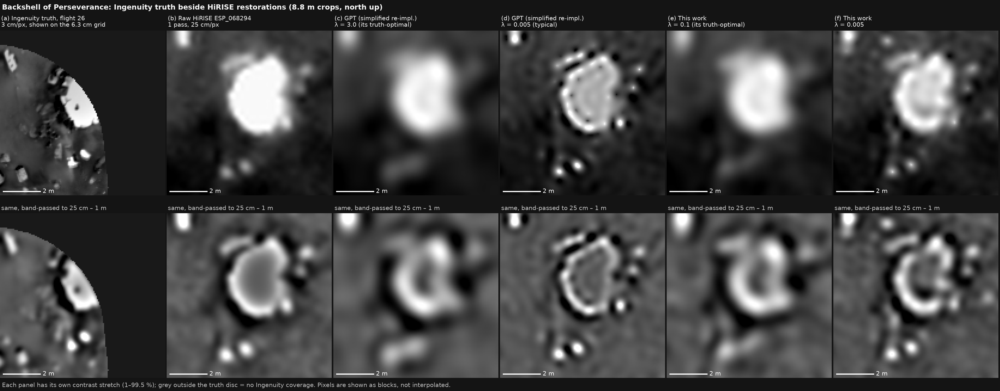
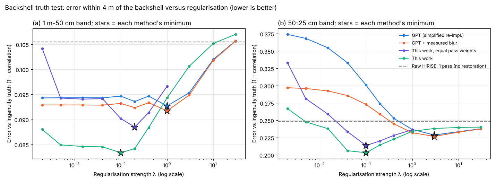

# Jezero Ground Truth Explorer

A browser-based Mars explorer and rover simulator built on real NASA data. Every pixel is labelled
**measured** or **simulated**, and both layers are scored in percentages against held-out
Perseverance rover photos.

- **Measured layer:** six overlapping HiRISE observations, fused.
- **Terrain:** the HiRISE stereo DTM.
- **Camera blur:** calibrated against rover ground truth.
- **Detail layer:** fine detail below HiRISE's reach, built from real rover texture, guided by an
  orbital surface-type classifier, and locked so it never alters what HiRISE measured.

Hero area: the Octavia E. Butler landing site and Perseverance's first 120 sols (646 m × 646 m).

## What is real, and what is not

| Layer | Source | Real detail |
|---|---|---|
| Base imagery | 6 HiRISE observations, fused | features ≳ 60 cm (measured limit of the data) |
| Terrain | HiRISE stereo DTM (DTEEC_045994_1985_046060_1985) | ~1 m posts |
| Rover corridor | Perseverance Navcam photos projected through each camera model | cm-scale, placed by rover localisation (±1–3 m) |
| Fine detail elsewhere | rover texture, classifier-guided | **simulated**: statistics match rover photos, exact pebble layout is not real |

The 25 cm HiRISE pixels do **not** contain real 5–10 cm detail. We measured this: across seven
lighting-matched observations, repeatable detail stops at about 40% of the sampling limit. Nothing
here claims otherwise. In the viewer, the provenance overlay (`P`) tints rover-measured detail green
and simulated detail red. Crowd tags are blocked on simulated pixels.

## Results (held-out rover stops; 100% = identical to the rover's view)

Twelve of the 35 rover stops in the hero area are held out. The texture library, amplitude
calibration and spectral shaping use only the other 23 stops.

| Method (4× upscale to 6.3 cm/px) | Spectral match | Texture match | Consistency with measurement |
|---|---|---|---|
| bicubic, single raw HiRISE frame | 15.2% | 57.6% | 100.0% |
| Lanczos, single raw frame | 15.3% | 57.9% | 99.9% |
| EDSR ×4 (off-the-shelf CNN), single raw frame | 15.2% | 57.4% | 98.1% |
| ESPCN ×4, single raw frame | 15.2% | 56.4% | 96.6% |
| FSRCNN ×4, single raw frame | 15.5% | 57.8% | 95.1% |
| EDSR ×4 on our fused frames | 15.9% | 58.8% | 98.3% |
| **Ours: fused + rover-texture detail** | **70.5%** | **75.3%** | **94.1%** |

How to read the columns:
- **Spectral match:** how much detail is present at each fine scale (6–25 cm) compared with the rover
  photo. It is `100·exp(−mean|ln(P_out/P_rover)|)`.
- **Texture match:** overlap of the gradient-magnitude distributions.
- **Consistency:** whether the output, seen back through the measured HiRISE blur and pixel,
  reproduces the measured image. It guards against invention.

All three are registration-free, because rover photos and orbital pixels can't be aligned to the cm.
Off-the-shelf upscalers stay consistent but add almost no real-looking fine detail. Ours adds
rover-calibrated detail and remains about 94% consistent with the measurement.

Other measured results:

| Result | Value |
|---|---|
| Measured layer: error predicting a held-out HiRISE frame, vs one raw frame | **25.4% lower** (6 frames) |
| HiRISE blur, calibrated against rover truth | σ = 0.78 px (≈20 cm), interquartile 0.68–0.86 px over 34 stops |
| Surface-type classifier vs guessing (held-out 100 m blocks), at 1 m / 4 m / 8 m | 3.7% / 4.1% / 6.0% lower composition error |
| Phone profile (390×844 @3×, CPU 4× throttled, **software GL, no GPU**) | full detail 30.5 fps · adaptive default 32 fps at full detail · 4.2 MB download (`data_products/perf.json`) |

The surface-type signal from orbit is weak. That's a property of the data, not a bug: it survived a
camera-geometry fix and several feature sets. So the detail layer leans on rover-calibrated amplitude
and texture more than on class identity.

<!-- BENCHMARK:START -->
## Paper benchmark: this work vs the UCL pipeline (all on CPU)

Method details: [`docs/METHODS.md`](docs/METHODS.md). Code: [`benchmark/run_benchmark.py`](benchmark/run_benchmark.py). Data: [`benchmark/data_manifest.json`](benchmark/data_manifest.json).

UCL did not release code or products. "UCL pipeline" is our re-implementation from the paper's equations, run on the same data and CPU.

**A. Simulation with exact truth** (5 scenes). Setup: fractal ground, 8 passes with the measured per-pass blur, non-rigid jitter, 3% noise, and one pass with a planted change. Every method estimates its own motion. The error columns are RMS error as % of the true scene contrast; lower is better.

| Method | Error at native 25 cm | Error at 6.25 cm output pixel | Artefact at the planted change (× scene std) |
|---|---|---|---|
| Raw HiRISE, one pass (bicubic) | 12.8% | 38.7% | 1.26 |
| Our previous pipeline (ECC + CG Tikhonov) | 5.2% | 34.8% | 1.48 |
| **UCL pipeline** (our re-implementation of Tao & Muller 2016: Gotcha + PDE-TV, assumed blur) | 3.6% | 30.2% | 1.43 |
| UCL + our weighting only | 4.7% | 32.6% | 1.09 |
| UCL + our measured per-pass blur only | 2.6% | 27.6% | 1.29 |
| This work with residual-based pass weights (rejected first version) | 1.4% | 29.9% | 1.03 |
| **This work** (Gotcha + noise-weighted, change-masked PDE-TV + measured per-pass blur) | 1.4% | 29.8% | 1.01 |
| This work with exact motion (upper bound) | 1.2% | 29.8% | 1.00 |

**This work vs UCL, paired by scene:**

- **25 cm:** -2.13 points (95% CI -2.21 to -2.02), a 60% relative reduction. Better in 5/5 scenes.
- **Artefact at the planted change:** -0.42 (95% CI -0.50 to -0.34). Better in 5/5 scenes.
- **6.25 cm:** -0.42 points (95% CI -0.53 to -0.29). Better in 5/5 scenes.

- **Ablation:** at the 6.25 cm output pixel, adding only our measured blur to UCL does best. The weighting trades a little fine-pixel error for robustness to changes between passes.
- **Ablation:** weighting without the measured blur makes UCL worse. Its residual-based pass weights are misled by the wrong blur model, so the two changes must go together.

**B. Real HiRISE, split-half consistency.** On a 32 m tile at 18.4472 N, 77.4127 E, 8 passes from 2007–2022 are split into two disjoint halves, each restored independently. The table gives the finest scale at which the two halves agree (coherence ≥ 0.5); smaller means more detail that is genuinely in the data.

| Method | Halves agree down to |
|---|---|
| Raw HiRISE, one pass (bicubic) | 100.0 cm |
| Our previous pipeline (ECC + CG Tikhonov) | 66.7 cm |
| **UCL pipeline** (our re-implementation of Tao & Muller 2016: Gotcha + PDE-TV, assumed blur) | 66.7 cm |
| UCL + our weighting only | 66.7 cm |
| UCL + our measured per-pass blur only | 66.7 cm |
| This work with residual-based pass weights (rejected first version) | 100.0 cm |
| **This work** (Gotcha + noise-weighted, change-masked PDE-TV + measured per-pass blur) | 66.7 cm |

**C. Real HiRISE, the parked rover's edge.** At the landing site, in 3 passes from sols 1–11, the table gives the width of Perseverance's edge in each restoration, together with the ringing that sharpening costs. Both ringing columns are a share of the rover's brightness step.

| Method | Edge width σ | Ringing (RMS) | Largest undershoot |
|---|---|---|---|
| Raw HiRISE, one pass (bicubic) | 23.3 cm | 9.2% | 18.1% |
| Our previous pipeline (ECC + CG Tikhonov) | 20.6 cm | 10.4% | 20.9% |
| **UCL pipeline** (our re-implementation of Tao & Muller 2016: Gotcha + PDE-TV, assumed blur) | 12.4 cm | 17.8% | 51.2% |
| UCL + our weighting only | 12.3 cm | 19.6% | 50.9% |
| UCL + our measured per-pass blur only | 13.1 cm | 12.7% | 37.3% |
| This work with residual-based pass weights (rejected first version) | 15.9 cm | 12.2% | 23.7% |
| **This work** (Gotcha + noise-weighted, change-masked PDE-TV + measured per-pass blur) | 15.9 cm | 13.3% | 25.2% |

**What this does and does not show.**

- **Gain at 25 cm.** It comes from two measured inputs, per-pass blur calibrated on the parked rover and per-pass/per-pixel weighting, added to UCL's method.
- **No 5 cm claim.** On real HiRISE, detail that repeats between independent sets of passes stops at about 67 cm; in simulation with exact truth, at about 33 cm. We do not claim the 5 cm resolution reported by UCL.
- **Unverified confidences.** The confidence-scored fill is calibrated in simulation. The rover answer key is misregistered by metres at most stops, so it cannot verify sub-metre confidences; see METHODS Section 7.

<!-- BENCHMARK:END -->

<!-- TRUTH:START -->
## Real physical truth: Ingenuity's view of the parachute and backshell

Ingenuity photographed the debris field from 8 m up (flight 26, sol 414) at about 3 cm per pixel. We placed that mosaic in HiRISE using two independent methods that agree (the helicopter's shadow plus the computed sun: **217° ± 12°**; image correlation on three independent HiRISE passes: **208°**, with the scale 0.0290 m/px equal to the nominal 8 m / 275 px). Details: [`docs/METHODS.md`](docs/METHODS.md) section 7c; figures in [`results/ingenuity/`](results/ingenuity/).



**Test on the backshell** (within 4 m; correlation with the truth in band-passed images, each method tuned to its own minimum of error; error = 1 − correlation, 50–25 cm band):

| Method | Error at its minimum | at λ = 0.005 | at λ = 0.04 |
|---|---|---|---|
| raw HiRISE (one pass) | 0.249 | — | — |
| UCL re-implementation | 0.229 (λ 3.0) | 0.368 | 0.333 |
| UCL + our measured blur | 0.227 (λ 3.0) | 0.296 | 0.286 |
| **This work** | **0.203** (λ 0.1) | 0.248 | 0.206 |



- **At the same regularisation, this work is much closer to the truth** than the UCL re-implementation (at λ = 0.04: 0.206 against 0.333).
- **Each tuned to its own minimum:** 1 m–50 cm +0.010 (95% CI +0.003 to +0.015); 50–25 cm +0.023 (95% CI -0.004 to +0.051) in correlation; both curves are U-shaped, so the minima are real.
- **Out of sample** (settings chosen on one half of the disc, scored on the other): +0.009 at 50–25 cm. Most of the in-sample gain comes from tuning on the same data.
- **Disc radius:** the 1 m–50 cm advantage is stable at 2.5, 4, 6 and 8 m (+0.007 to +0.010 in correlation, bootstrap interval above zero at 4, 6 and 8 m); the 25–50 cm advantage is not (it disappears at 8 m, where the patch includes the rock field the truth cannot resolve at that scale).
- **Placement robustness:** ahead of UCL in 91% of 45 plausible placements at 50–25 cm.
- **Limits:** one 1.5 m object, chosen after a 181 m² rock-field patch proved uninformative (the truth was taken at midday and HiRISE in the afternoon, so rocks look completely different); this cannot establish a general result.

<!-- TRUTH:END -->

## How it works

1. **Fusion** (`scripts/build_hero_measured.py`):
   - registers six lighting-matched HiRISE observations to the DTM-controlled orthoimage,
     coarse first, then dense per-pixel motion;
   - matches their photometry;
   - applies a quality gate (only tiles that truly agree are used);
   - fuses with a trimmed mean.
2. **Rover ground truth** (`scripts/build_rover_truth.py`): projects Perseverance Navcam photos onto
   the ground with the per-image CAHVORE camera model and rover attitude, at 5 cm/px. AI4Mars labels
   supply the surface class and mask the rover body.
3. **Blur calibration** (`scripts/calibrate_psf.py`): compares rover-truth spectra with HiRISE spectra
   at 34 stops. No pixel alignment is needed, and lighting gain cancels out.
4. **Detail layer** (`pipeline/detail.py`):
   - takes real rover texture per surface class;
   - mixes classes with variance-preserving fuzzy weights from the orbital classifier;
   - sets amplitude from rover-measured fine/coarse contrast, corrected for HiRISE attenuation;
   - adjusts gain and spectral shape on training stops only;
   - applies a consistency lock that removes anything HiRISE would have seen.
5. **Viewer** (`web/`): Three.js r128 from a CDN, no build step. The detail is synthesized in a single
   fragment shader from small textures. It's baked once per 8 m of driving into a 64 m texture, so each frame reads one
   value per pixel. That keeps it cheap on phones. It also includes:
   - adaptive render scale with an FSR1-style sharpening pass
   - a drivable 6-wheel rover with ground clamping, chase and 1.8 m mast cockpit cameras
   - gyro look-around, with the iOS permission handshake
   - dust-storm opacity (τ)
   - real-slope limits from the DTM and a survey boundary
   - reticle tagging into a stubbed ledger that's ready to swap for Supabase

## Run it

```bash
pip install -r requirements.txt
python scripts/fetch_data.py data                      # ~9 GB of public NASA data
python scripts/build_rover_truth.py data/navcam data/rover/meta data/ai4mars/ai4mars-dataset-merged-0.6/m2020/labels \
       data/rover/waypoints.json data/rover/hero_navcam.json data/hero/rover_truth
python scripts/calibrate_psf.py data/hero/rover_truth data/hirise_jezero/ESP_045994_1985_RED_A_01_ORTHO.JP2 data_products/psf_calibration.json
python scripts/build_hero_measured.py data/hirise_jezero data/hirise_rdr data/hero
python scripts/build_surface_groundtruth.py data NAV && python scripts/train_surface_classifier.py data NAV 30 4
python scripts/evaluate_hero.py data/hero data/hero/rover_truth <sr_models_dir> data/rover/cells_NAV_4m.npz \
       data/hirise_jezero/ESP_045994_1985_RED_A_01_ORTHO.JP2 data/hero/scores.json
python scripts/export_web.py data/hero data/hero/rover_truth data/hirise_jezero/DTEEC_045994_1985_046060_1985_U01.IMG \
       data/hirise_jezero/ESP_045994_1985_RED_A_01_ORTHO.JP2 data/rover/cells_NAV_4m.npz data/rover/waypoints.json web/data data/hero/scores.json
cd web && python -m http.server 8000                   # open http://localhost:8000
```

`<sr_models_dir>` holds the OpenCV `EDSR_x4.pb`, `ESPCN_x4.pb` and `FSRCNN_x4.pb` models, which are
used only as baselines. The `tests/` folder runs on synthetic ground truth: `pytest`.

## Limitations

- **One hero site,** with 12 held-out stops. Wider validation is the next step.
- **Rover truth geometry:** it assumes locally flat ground (projection limited to 1.5–8 m from the
  rover). Mosaics average several photos, which slightly blurs the reference, so the PSF estimate may
  be a little low.
- **Rover corridor placement:** it relies on rover localisation. Rover photos could not be registered
  to HiRISE pixels at the cm level, under any orientation or scale.
- **The simulated layer is statistically grounded, not real at the pebble level.** It is always
  labelled, and tags are blocked on it.
- **Performance numbers** come from a headless software-GL phone profile, not a physical phone.

## Data credits

NASA/JPL-Caltech/University of Arizona (HiRISE). NASA/JPL-Caltech (Mars 2020 Navcam raw images,
MMGIS traverse). AI4Mars dataset (Zooniverse / NASA JPL, CC-BY-4.0).
