# Revisiting Repeat-Pass Super-Resolution of HiRISE: Measured Blur, Measured Noise, and Centimeter-Scale Truth From Ingenuity

**[Author Name 1]1**, **[Author Name 2]2**

1 [Department, Institution, City, Country]; ORCID [0000-0000-0000-0000]

2 [Department, Institution, City, Country]; ORCID [0000-0000-0000-0000]

**Corresponding author:** [Name] ([email address])

**Keywords:** Mars; HiRISE; super-resolution; Ingenuity; image restoration; Jezero crater

## Key Points

- Measuring each HiRISE pass's blur and noise improves multi-pass image restoration, tested against Ingenuity helicopter images at two sites
- Settings tuned at one Ingenuity site transfer to the other for the new method, but not for the Gotcha–PDE-TV baseline
- Independent passes confirm detail to about 67 cm, and HiRISE optics pass nothing finer than about 20 cm

## Abstract

Multi-pass super-resolution restoration of HiRISE images has been reported to recover detail far below the 25 cm pixel, but such results have rarely been tested against independent truth. Building on the Gotcha–PDE-TV (GPT) method of Tao and Muller (2016), we measure each pass's blur on a static target and weight each pass by its measured noise. We evaluate restorations of the Perseverance landing area in Jezero crater against centimeter-scale truth at two sites imaged by the Ingenuity helicopter. In simulation, the measured inputs lower the error at the native 25 cm scale from 3.49% to 1.38% of scene contrast, provided each pass's blur is known to within 20%. Against the Ingenuity truth, our restoration is closer to the ground than every GPT variant at a fixed regularization strength. With each method fully tuned, the advantage is small, and statistically clear only in the 50–25 cm band at the second site (+0.017 (95% interval +0.006 to +0.026) in correlation). Settings chosen at one truth site transfer to the other with almost no loss for our method, but not for GPT, which then falls to or below a single raw pass. Detail confirmed by independent pass subsets reaches about 67 cm, and HiRISE's optics pass nothing finer than about 20 cm in half-period, so the output grid of such restorations should not be read as their resolution. A pass-subset bootstrap gives conservative per-pixel uncertainties at 25 cm.

## Plain Language Summary

The HiRISE camera orbiting Mars takes pictures in which each pixel covers 25 cm of ground. By combining several pictures of the same place taken on different orbits, computer methods can produce sharper images, and some studies have reported detail as fine as 5 cm. It has been hard to check how much of that detail is real, because there were no independent pictures of the ground at that scale. The Ingenuity helicopter changed this: it photographed the ground at Jezero crater from a few meters up. We used two of its sites as an answer key. We found that measuring how blurred and how noisy each orbital picture is, instead of assuming it, makes the combined image closer to what Ingenuity saw. The improvement is modest, but it carries over from one site to the other, which the earlier method's settings do not. We also show that real detail stops at about two thirds of a meter in these images, and that the telescope itself cannot record anything finer than about 20 cm, so a 5 cm grid does not mean 5 cm detail.

## 1. Introduction

The HiRISE camera on Mars Reconnaissance Orbiter images the surface at about 25 cm per pixel (McEwen et al., 2007). That is enough to see boulders a metre across, but not the smaller rocks, ripples and fractures that matter for rover traverses and for choosing targets on the ground. Many sites have been imaged repeatedly, and each pass samples the ground on a slightly different grid. A stack of passes therefore holds information that no single image has, which multi-image super-resolution restoration can recover.

**The GPT result.** Tao and Muller (2016) developed Gotcha–PDE-TV (GPT) for exactly this purpose. Each pass is aligned to a reference image to sub-pixel accuracy with the Gotcha matcher (Otto & Chau, 1989). The method then solves for a fine image whose blurred and down-sampled copies match every pass, with a fourth-order regulariser that keeps edges (You & Kaveh, 2000). Applied to eight HiRISE passes over the Spirit rover's traverse at Home Plate, Gusev crater, GPT produced a mosaic on a 5 cm grid, described as a 5 times higher resolution. They supported it in three ways:
- the spacing of the rover's wheel tracks in the restored image matched the rover's own Navcam mosaic to within 8 cm (1.6 restored pixels);
- automatic detection found 153 rocks of 30 cm or more, against 23 in the original image;
- side-by-side views showed rocks, edges and tracks far more clearly than in the 25 cm input.

The same group later moved to learned single-image methods, such as MARSGAN, and judged those by the sharpness of high-contrast edges (Tao et al., 2021).

**What was left open.** Tao and Muller are explicit about three limits of their study:
1. **The blur.** The point-spread function was "assumed to be a small Gaussian kernel with standard deviation σ 0 to 1", chosen by region. It was not measured.
2. **The resolution.** Of the output grid, they write that they "determined this heuristically at the 5 cm shown for the 8 input 25 cm images". They wrote that they did "not yet know, and are not able to test, owing to the huge computational time, how many images yield what resolution".
3. **The validation.** The wheel-track check and the rock counts confirm where edges lie and how many objects are detected, but there was no independent image of the ground at centimetre scale. Neither check can show whether the 5 cm detail between those edges is real.

**What has changed.** The Perseverance landing area at Jezero now has many HiRISE passes, taken from 2007 to 2024. Among them is a compact bright boulder that is unchanged in every pass, a natural target for measuring each pass's blur. The Ingenuity helicopter photographed the ground from a few metres up on many flights. On its 26th flight it imaged the descent backshell at about 3 cm per pixel, and for flights 4–5 JPL published an orthorectified 1 cm mosaic of the area south of the landing spot. Both are independent, centimetre-scale views of the ground.

**This paper.** We revisit GPT on each of the three open points:
1. **Blur.** We measure each pass's blur on the boulder and its noise from the image, and use both in place of GPT's assumed blur (Sections 3–4).
2. **Validation.** We test against exact truth in simulation and against the Ingenuity truth at two real sites (Sections 6.1–6.2).
3. **Resolution.** We measure, on real HiRISE, the finest scale at which two independent sets of passes agree. With simulation and the telescope's diffraction limit, this bounds the resolution that eight passes can deliver (Sections 6.3 and 7.1).

We also give a per-pixel uncertainty from a bootstrap over passes (Section 6.4). Throughout, our baseline is GPT as described in the 2016 paper, with its assumed blur. The code is not public, so we re-implemented it from the paper; it differs only where stated (Section 4).

## 2. Background

**Repeat-pass restoration.** Each low-resolution pass `Y_k` is modelled as the unknown fine image `X`, warped by the pass's motion, blurred by its point-spread function and down-sampled. A maximum a posteriori estimate balances fit to all passes against a smoothness prior. GPT obtains the motion with Gotcha, a region-growing matcher built on adaptive least-squares correlation (Otto & Chau, 1989; Gruen, 1985), seeded by scale-invariant features (Lowe, 2004). Its prior is a fourth-order PDE regulariser (You & Kaveh, 2000), which avoids the staircase artefacts of plain total variation. Later work by the same group moved to learned single-image methods such as MARSGAN (Tao et al., 2021). These produce sharp images, but their added texture comes from training data, so measured and learned detail cannot be told apart.

**Why the blur matters.** The restoration undoes each pass's blur. If the assumed blur is larger than the true blur, the method sharpens too hard and creates ringing next to edges. If it is smaller, real detail is left smeared. Because HiRISE passes differ, a single assumed blur is wrong for most of them.

**How restorations have been judged.** Resolution claims have rested on visual comparison, counts of detected features, and edge sharpness. All three favour a crisper image whether or not the extra detail is real. A fair test needs truth that is independent of the HiRISE passes and finer than them.

## 3. Data

**HiRISE passes.** Of 10 HiRISE RED observations of the Jezero landing area from 2007 to 2024, we use the eight with similar sun azimuth (165–178°); the other two were taken under different illumination. The eight span 2007–2022, with view angles from 2° to 24° off nadir. All share one map projection, so passes are aligned to the pixel by an integer shift and refined to sub-pixel accuracy by Gotcha.

**Test areas.** We use three areas. The first is a texture-rich 32 m tile at 18.4472 N, 77.4127 E, seen in all eight passes. The second, a 32 m tile near the landing area at 18.4456 N, 77.4520 E, contains a compact bright boulder of about 2.5 × 1.8 m (Figure 1). Because the boulder is present and unchanged in every pass, it serves as a common target for measuring blur. The third is the area around the backshell, where Ingenuity's images provide truth.

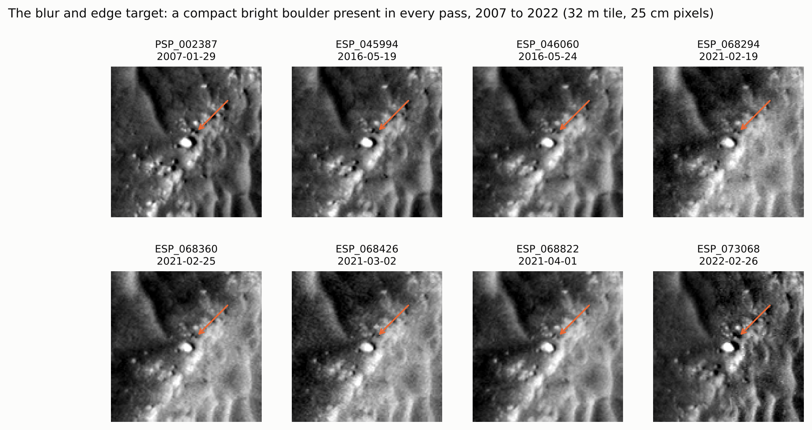

**Figure 1.** The blur target: a compact bright boulder visible in every pass from 2007 to 2022 (arrow). Each panel is the same 32 m tile after alignment, at 25 cm per pixel.

**Alignment across fifteen years.** As a check on registration, Figure 2 shows the parachute and backshell 1.1 km west of the boulder tile. They are absent in 2007 and 2016 and appear from the first pass after landing, at the same position in every later pass.

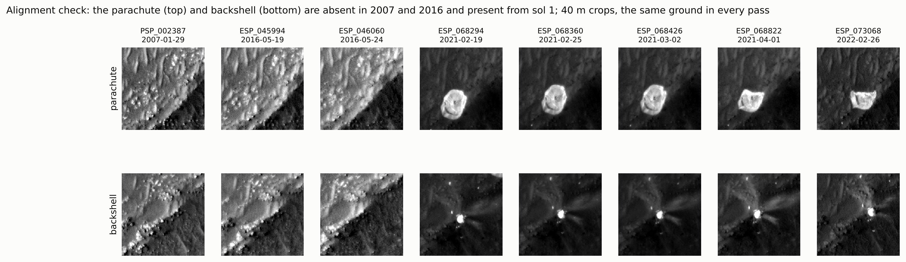

**Figure 2.** The parachute (top) and backshell (bottom), absent before landing and present at the same place in every pass after it. 40 m crops; the parachute's change of shape after March 2021 is visible.

**Ingenuity truth.** On its 26th flight (sol 414), Ingenuity photographed the parachute and backshell from about 8 m with its downward navigation camera, at about 3 cm per pixel. We rectified the fisheye frames and built a mosaic around the backshell. We placed it in HiRISE by two independent methods: the direction of the helicopter's own shadow against the computed sun, and image correlation against three separate HiRISE passes. The two agree on the rotation within their uncertainty (217° ± 12° from the shadow, 208° from correlation), and the correlation recovers the scale expected from the flight height.

**Second truth site.** For flights 4–5 (sol 76), JPL published an orthorectified mosaic of the downward camera at 1 cm per pixel, covering 170 × 60 m south of the landing spot in the rover's site frame 3. That frame is level and aligned with north, so placing the mosaic in HiRISE needs only a shift. A coarse correlation at 1 m found the same position in both post-landing passes tested (the pre-landing passes lack the landing marks and disagree), and the bright patches scoured by the descent stage's engines appear in both the mosaic and HiRISE. A refined correlation at 25 cm gives a sharp, unambiguous peak (0.69 against a runner-up of 0.08 in the 25 cm–1 m band). The same placement also locates the rover's landing spot, the origin of site 3, in our HiRISE grid. We test on a 32 m tile 40–75 m south of it, where 73% of the ground is covered. The tile lies south of every position the rover had reached by sol 76, so it is free of rover tracks in the truth image.

## 4. Method

**Forward model.** We estimate the fine image `X`, on a grid four times finer than HiRISE (6.25 cm), by minimising

`E(X) = Σ_k w_k Σ_p m_kp (A_k X − Y_k)_p² + λ Σ_p sqrt(|∇²X|² + μ²)`,

where `A_k` warps `X` by pass k's motion, blurs it with that pass's own Gaussian of width `σ_k`, and down-samples it. The second term is the fourth-order regulariser of GPT, and λ sets its strength. We solve with accelerated gradient descent. The step size comes from the largest eigenvalue of the forward operator, which we measure by power iteration.

**Measured blur.** On three passes we fit brightness profiles across the boulder's short axis with a blurred bar. The other passes are matched to the sharpest one on static ground, which gives their extra blur. The resulting widths range from 0.59 to 1.43 HiRISE pixels. A boulder edge is not a perfect step, so the absolute widths are upper bounds. The ratios between passes are what the restoration relies on.

**Noise weights.** Each pass's weight `w_k` is the inverse of its white-noise variance, measured from its finest-scale pixel differences (Immerkær, 1996). This is deliberately independent of the fit. Weights based on the fit residual, the obvious alternative, read lighting differences between passes as noise, and on real data collapse onto a single pass: split-half coherence falls to 0.199, below either GPT variant (Section 6.3). Robust per-pixel weights `m_kp` (Tukey) limit the influence of pixels that disagree strongly in one pass.

**Uncertainty.** We rebuild the restoration from passes drawn with replacement. The spread of these rebuilds, scaled by a single factor fitted on one simulated scene and tested on another, gives a per-pixel uncertainty.

**Baseline.** Our GPT baseline follows the paper's equations with one assumed blur width for every pass and no weighting. The original varies the blur width between 0 and 1 pixel by image region, which we did not reproduce, so we refer to it as a simplified re-implementation. To make sure the baseline is not handicapped by our choice of width, we run it at 0.5, 0.75 and 1 pixel and report the best. Its components (Gotcha alignment, the regulariser, the solver) are the same as ours, so the comparison isolates the effect of measured blur and noise.

## 5. Experiments

We use four tests, each answering a different question.

- **A. Simulation with exact truth.** Fractal ground, eight passes with the measured blurs, random sub-pixel offsets plus 0.3-pixel jitter, 3% noise, and a 2 m change planted in one pass. Every method estimates its own motion. This test asks how close each restoration is to the true ground (20 scenes).
- **B. The Ingenuity truth.** Within 4 m of the backshell, and over 626 m² at the second site, we compare each restoration with Ingenuity's view in two bands, 1 m–50 cm and 50–25 cm. We use band-passed correlation with a ±25 cm placement tolerance applied equally to all methods. This test asks whether the restored detail matches the real ground.
- **C. Real-data consistency.** We split the eight real passes into two disjoint halves and restore each half separately. Detail that both halves agree on comes from the data, not the prior. This test asks down to what scale the detail is real.
- **D. A real edge.** On the boulder, we measure the edge width of each restoration together with the ringing and undershoot beside it. This test asks how much artefact each method pays for its sharpness.

## 6. Results

### 6.1 Simulation: measured blur and noise reduce the error at 25 cm

Table 1 and Figure 3 summarise the simulation. At the native 25 cm scale, the GPT baseline with its best assumed blur (1 pixel) leaves an error of 3.49% of scene contrast; smaller assumed blurs do worse (6.58% at 0.75 pixel, 8.75% at 0.5). Using the measured blur alone reduces it to 2.64%. Adding noise weighting and robust pixel weights brings it to 1.38%, 60% lower than the baseline, and the improvement holds in every scene. With exact motion the error would be 1.17%, so alignment is not the limiting step. Noise weighting without the measured blur makes the result worse (4.23%): weights only help once the blur model is right.

The simulation's passes are generated with the measured blurs, so our method is given the exact blur, which favours it by construction. To test how much this matters, we also run it with every blur 20% too small and 20% too large. The 25 cm error then rises to 4.65% and 5.69%, worse than GPT's 3.49%, and worse in every one of the 20 scenes. In simulation, the gain therefore depends on knowing each pass's blur accurately; a 20% error is enough to lose it. On the boulder, the spread between individual edge profiles is 7–17% of the fitted width, so a residual error of that order cannot be ruled out. The real-data truth test is far less sensitive (Section 6.2).

At the finer 6.25 cm output pixel all methods remain far from the truth (errors near 30%), and here our method (27.9%) is slightly worse than GPT with measured blur alone (26.1%). This is the first sign that detail at that scale is not being recovered.

**Table 1.** Simulation with exact truth, mean over 20 scenes. Lower is better. "This work" uses the blur the passes were generated with; the last two rows give it a wrong blur.

| Method | Error at 25 cm (%) | Error at 6.25 cm (%) | Largest error at planted change (× std) |
|---|---|---|---|
| Raw HiRISE, one pass | 12.06 | 36.3 | 1.19 |
| GPT (simplified re-implementation), assumed blur 1 px | 3.49 | 28.4 | 1.38 |
| GPT, assumed blur 0.75 px | 6.58 | 30.5 | 1.33 |
| GPT, assumed blur 0.5 px | 8.75 | 33.2 | 1.35 |
| GPT + noise weighting | 4.23 | 30.5 | 1.02 |
| GPT + measured blur | 2.64 | 26.1 | 1.24 |
| **This work** (measured blur + noise weighting) | 1.38 | 27.9 | 0.96 |
| This work with exact motion (upper bound) | 1.17 | 27.9 | 0.96 |
| This work, blur assumed 20% too small | 4.65 | 29.3 | 1.00 |
| This work, blur assumed 20% too large | 5.69 | 29.9 | 1.03 |

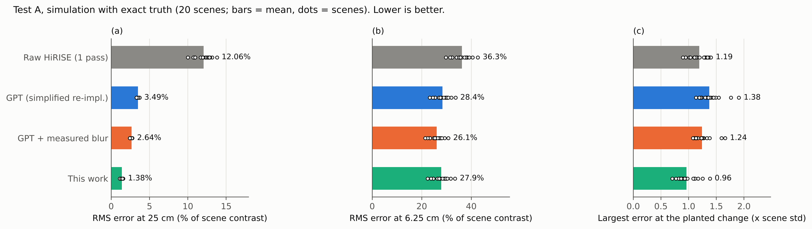

**Figure 3.** Simulation with exact truth. (a) Error at the native 25 cm scale, (b) at the 6.25 cm output pixel, (c) the largest error at a change planted in one pass. Bars are means and dots are individual scenes.

### 6.2 First truth site: the backshell

Figure 4 shows the error against Ingenuity's view as the regularisation strength λ varies. At a fixed λ = 0.04, our restoration is clearly closer to the ground than the GPT baseline in the 50–25 cm band (0.206 against 0.333, where 0 is perfect agreement; 0.267 for GPT with a 0.5 pixel blur). It also does better in the 1 m–50 cm band (0.085 against 0.094). When each method is tuned, with GPT allowed to choose its assumed blur as well as λ, the advantage is smaller: +0.009 (95% interval +0.002 to +0.016) in correlation at 1 m–50 cm and +0.023 (95% interval -0.004 to +0.051) at 50–25 cm. Out of sample, choosing settings on one half of the area and scoring on the other, the 50–25 cm advantage remains (0.824 against 0.817 for the best GPT variant), but at 1 m–50 cm GPT with a 0.5 px blur is level with or slightly ahead of ours (0.945 against 0.943). Scaling our measured blur by 0.8 or 1.2 changes the tuned advantage at 1 m–50 cm only from +0.010 (95% interval +0.003 to +0.015) to +0.008 and +0.011, so on real data the gain does not hinge on a precise blur. Across 45 plausible placements of the truth, our restoration is ahead in 84% of placements at 1 m–50 cm and 91% at 50–25 cm. The 1 m–50 cm advantage is stable across the radius of the test area (2.5–8 m); the 50–25 cm advantage is not.

**Table 2.** Error against the Ingenuity truth (1 − correlation) within 4 m of the backshell, at a fixed λ and at each method's own best λ. Lower is better.

| Method | Error, λ = 0.04 (50–25 cm) | Error at own best λ (50–25 cm) | Error, λ = 0.04 (1 m–50 cm) | Error at own best λ (1 m–50 cm) |
|---|---|---|---|---|
| Raw HiRISE, one pass | 0.249 | – | 0.105 | – |
| GPT, assumed blur 1 px | 0.333 | 0.229 (λ = 3.0) | 0.094 | 0.093 (λ = 1.0) |
| GPT, assumed blur 0.75 px | 0.291 | 0.230 (λ = 3.0) | 0.093 | 0.092 (λ = 1.0) |
| GPT, assumed blur 0.5 px | 0.267 | 0.232 (λ = 3.0) | 0.092 | 0.092 (λ = 0.1) |
| GPT + measured blur | 0.286 | 0.227 (λ = 3.0) | 0.093 | 0.092 (λ = 1.0) |
| **This work** | 0.206 | 0.203 (λ = 0.1) | 0.085 | 0.083 (λ = 0.1) |

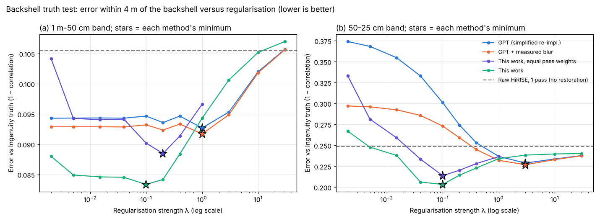

**Figure 4.** Error against Ingenuity's view versus regularisation strength, in (a) the 1 m–50 cm and (b) the 50–25 cm band. Stars mark each method's minimum; the dashed line is raw HiRISE.

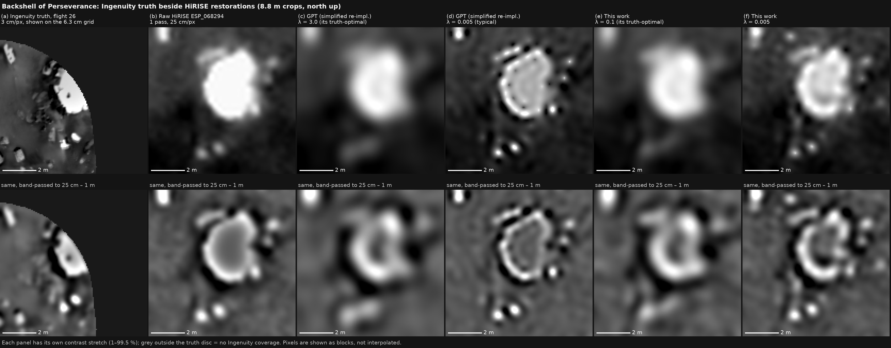

**Figure 5.** The backshell neighbourhood: (a) Ingenuity's view beside (b) raw HiRISE and (c–f) restorations at each method's best and at a typical λ. The bottom row is band-passed to 25 cm–1 m, the scales the test scores.

### 6.2b A second truth site confirms the result

At the second site, south of the landing spot, the comparison covers 626 m² of ordinary Jezero ground: rock clusters, sand and outcrop edges (Figures 6 and 7, Table 3). At a fixed λ = 0.04, our restoration is again closer to the truth than every GPT variant: 0.334 against 0.348 for the best of them in the 50–25 cm band, and 0.242 against 0.253 at 1 m–50 cm. With every method tuned, and GPT allowed to choose its blur as well as λ, our advantage is +0.017 (95% interval +0.006 to +0.026) in correlation at 50–25 cm, an interval that excludes zero. At 1 m–50 cm it is +0.007 (95% interval -0.000 to +0.015). Giving our method a blur that is 20% too small or too large leaves the 50–25 cm advantage in place: +0.019 (+0.010 to +0.026) and +0.012 (+0.002 to +0.021).

Out of sample, the 50–25 cm advantage holds (0.691 against 0.682 for the best GPT variant). At 1 m–50 cm, no restoration does better than a single raw pass (0.746 for raw HiRISE, 0.745 for ours, 0.740 for the best GPT variant): at that scale the extra passes add little that the truth can confirm. Across both sites, then, the clearest gain from measured blur and noise is in the finest band that HiRISE resolves, 50–25 cm.

**Settings transfer between sites.** In real use there is no truth at the target, so settings must be chosen elsewhere. We therefore choose each method's settings on one truth site and score them on the other (Table 4). In the 50–25 cm band, our settings lose at most 0.011 in correlation against the best possible at the target. GPT's, even with its blur chosen as well, lose 0.046–0.052. Tuned on the second site and applied to the backshell, GPT falls below a single raw pass (0.719 against 0.751), while ours reaches 0.786. Measuring each pass's blur makes the restoration's behaviour predictable from one site to another; an assumed blur does not.

**Table 4.** Cross-site transfer: correlation with the truth (higher is better) when settings are chosen on one site and scored on the other. In brackets, the best possible at the target with that method's own settings.

| Band | Settings chosen on | Scored on | GPT (blur and λ chosen) | GPT + measured blur | **This work** | Raw HiRISE |
|---|---|---|---|---|---|---|
| 50–25 cm | backshell | site 2 | 0.607 (0.653) | 0.601 (0.650) | 0.669 (0.670) | 0.604 |
| 50–25 cm | site 2 | backshell | 0.719 (0.771) | 0.741 (0.773) | 0.786 (0.797) | 0.751 |
| 1 m–50 cm | backshell | site 2 | 0.747 (0.754) | 0.742 (0.753) | 0.760 (0.762) | 0.753 |
| 1 m–50 cm | site 2 | backshell | 0.899 (0.908) | 0.898 (0.908) | 0.912 (0.917) | 0.895 |

**Table 3.** Second truth site: error against the Ingenuity truth (1 − correlation) over 626 m². Lower is better.

| Method | Error, λ = 0.04 (50–25 cm) | Error at own best λ (50–25 cm) | Error, λ = 0.04 (1 m–50 cm) | Error at own best λ (1 m–50 cm) |
|---|---|---|---|---|
| Raw HiRISE, one pass | 0.396 | – | 0.247 | – |
| GPT, assumed blur 1 px | 0.356 | 0.350 (λ = 0.2) | 0.254 | 0.246 (λ = 10.0) |
| GPT, assumed blur 0.75 px | 0.349 | 0.347 (λ = 0.1) | 0.253 | 0.246 (λ = 10.0) |
| GPT, assumed blur 0.5 px | 0.348 | 0.348 (λ = 0.04) | 0.253 | 0.246 (λ = 10.0) |
| GPT + measured blur | 0.352 | 0.350 (λ = 0.2) | 0.253 | 0.247 (λ = 10.0) |
| **This work** | 0.334 | 0.330 (λ = 0.2) | 0.242 | 0.238 (λ = 0.4) |

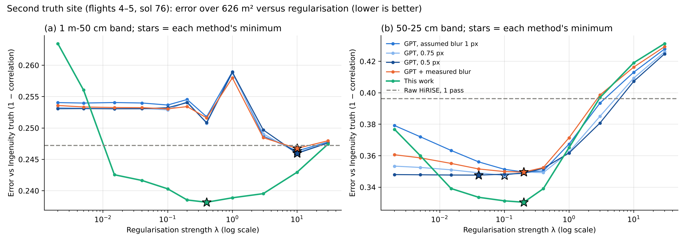

**Figure 6.** Second truth site: error against Ingenuity's view versus regularisation strength in (a) the 1 m–50 cm and (b) the 50–25 cm band. Stars mark each method's minimum; the dashed line is raw HiRISE.

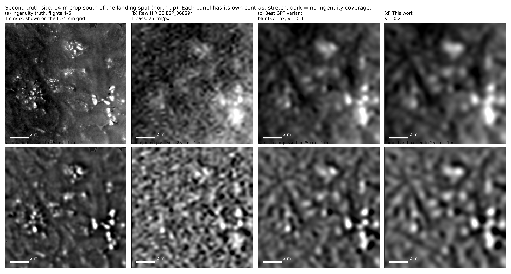

**Figure 7.** Second truth site, a 14 m crop: (a) the Ingenuity mosaic beside (b) raw HiRISE, (c) the best GPT variant and (d) this work, each at its own best setting. The bottom row is band-passed to 25 cm–1 m.

### 6.3 Real HiRISE: where detail stops being real

Restoring two disjoint halves of the real passes, four passes each, gives a direct measure of repeatable detail (Figure 8). For every method, the two halves agree well at scales above about 1 m and stop agreeing near 67 cm. Because each half has only four passes, this is a conservative figure for an eight-pass restoration. Below that, neither the GPT baseline nor our restoration recovers detail that the other half confirms. Over 25–100 cm the GPT baseline's halves agree slightly more than ours (0.263 against 0.230).

On the boulder edge (Figure 9), the GPT baseline produces the narrowest edge (14.1 cm against 16.7 cm), but at a price. Its ringing is 16.2% of the edge step against 11.7% for ours, and its largest undershoot is 42% against 26%. The assumed blur is larger than the measured blur of the sharpest passes, so the baseline deconvolves too hard. Edge sharpness alone therefore rewards a wrong blur model. Figure 10 shows the restorations side by side.

**Table 5.** Real HiRISE. The split-half columns come from the texture tile (eight passes, two halves of four); the edge columns from the boulder tile (three passes, sols 1–11). Higher coherence is better; a narrower edge is sharper; lower ringing is cleaner.

| Method | Split-half coherence, 25–100 cm | Halves agree down to | Boulder edge σ (cm) | Ringing (% of step) | Largest undershoot (% of step) |
|---|---|---|---|---|---|
| Raw HiRISE, one pass | 0.183 | 100 cm | 23.3 | 9.2 | 18.1 |
| GPT (simplified re-implementation) | 0.263 | 67 cm | 14.1 | 16.2 | 42.2 |
| GPT + measured blur | 0.225 | 67 cm | 14.9 | 11.6 | 30.0 |
| **This work** | 0.230 | 67 cm | 16.7 | 11.7 | 25.6 |

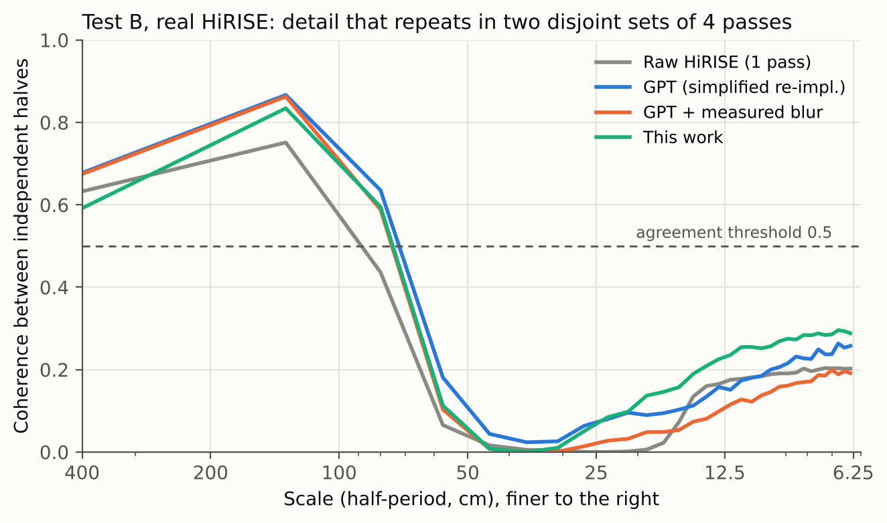

**Figure 8.** Agreement between restorations made from two disjoint sets of four real passes, against scale. Detail counts as repeatable where coherence is at least 0.5 (dashed).

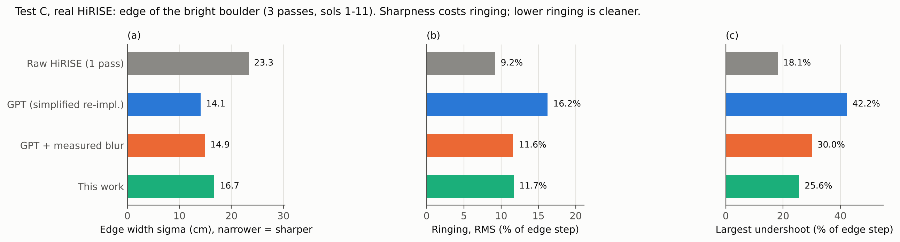

**Figure 9.** The boulder edge on real HiRISE: (a) edge width, (b) ringing, (c) largest undershoot.

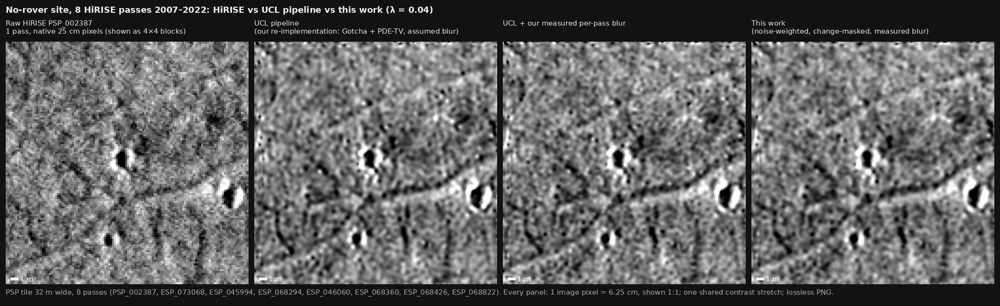

**Figure 10.** Eight real passes, 32 m tile. (a) One raw pass; (b) GPT baseline (1 pixel blur); (c) GPT with measured blur; (d) this work. 6.25 cm pixels shown 1:1 with one shared contrast stretch.

### 6.4 Uncertainty

After calibration on one simulated scene, the bootstrap uncertainty covers the true error on a single held-out scene in 86% of pixels at ±1σ and 99% at ±2σ, at the native 25 cm scale (Figure 11). That is more than the nominal 68% and 95%, so the uncertainty errs on the safe side. At the 6.25 cm output pixel, coverage can be matched by calibration, but the uncertainty no longer ranks which pixels are wrong, so we report it at 25 cm.

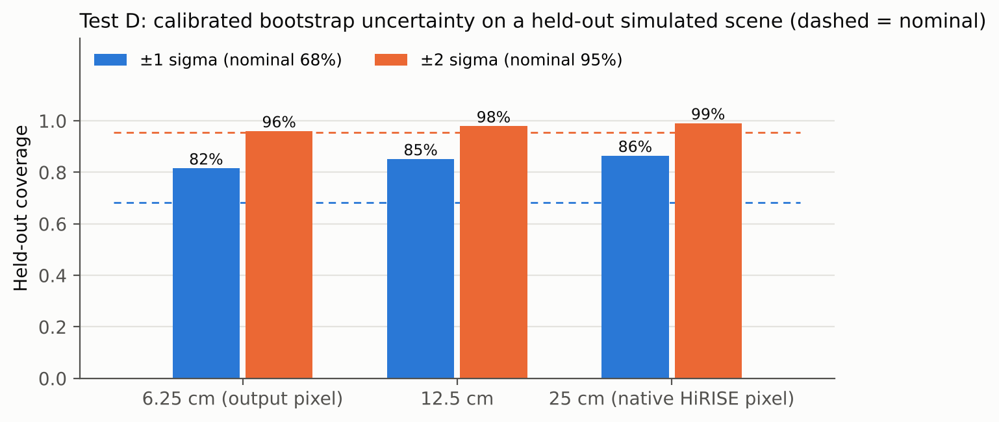

**Figure 11.** Held-out coverage of the calibrated bootstrap uncertainty at three scales; dashed lines are the nominal 68% and 95%.

## 7. Discussion

### 7.1 Tao and Muller's three open points, revisited

**The blur.** GPT assumes a Gaussian blur of 0 to 1 pixel. On the boulder, the measured blur of the eight passes ranges from 0.59 to 1.43 HiRISE pixels. These are upper bounds, and GPT does not state the units of its σ, but on our measurement 5 of 8 passes are blurrier than 1 HiRISE pixel. A single assumed value is therefore too sharp for some passes and too soft for others, and in simulation no single value (0.5, 0.75 or 1 pixel) closes the gap. In simulation, correcting the blur alone accounts for about 40% of our gain at 25 cm (3.49% to 2.64%). Noise weighting and the robust pixel weights together provide the rest (Section 6.1); we did not separate those two. It also explains why GPT's restored edges are crisp: the method deconvolves too hard, which shows up as ringing beside edges (Section 6.3).

**The resolution.** Independent four-pass halves of the real data agree on detail down to about 67 cm. In simulation with exact truth, eight-pass restorations resolve about 29–33 cm: 33 cm for ours and 29 cm for GPT with measured blur (all as half-periods). There is also a hard physical limit. HiRISE has a 0.5 m aperture and its RED band is centred at 700 nm. At MRO's range to the surface of roughly 260–320 km, the optics transmit no ground pattern with a period shorter than λR/D ≈ 36–45 cm, a half-period of about 18–22 cm. Sub-pixel shifts between passes can undo the aliasing of HiRISE's pixel grid, but they cannot recover what the telescope never passed, so no number of passes can show real 5 cm detail. The simulated figures are coarser than this limit and coarser than the 25 cm half-period of the native pixel grid. The simulation models the blur as a Gaussian and has no hard cutoff, so it is not a direct test of the diffraction limit. Both point the same way: real detail stops well above 5 cm. This does not contradict the 2016 results: wheel-track spacing to within 8 cm tests where edges lie, and a fine grid with an edge-preserving prior places edges very precisely. It does mean that "5 cm" describes the sampling of the output, not the size of the smallest real detail it contains. Our passes span view angles of 2° to 24°, comparable to the view-angle differences of at least 8° in the Gusev stack, so we expect a similar limit there; we have not tested Gusev.

**The validation.** Ingenuity's images are, to our knowledge, the first centimetre-scale truth against which HiRISE restorations have been scored, here at two independent sites. Against it, the measured-blur restoration is clearly closer to the ground than the GPT baseline at the same regularisation strength. Once each method is tuned, including GPT's blur, the advantage is small. At both sites it holds out of sample in the 50–25 cm band, and at the second site it is statistically clear there. At 1 m–50 cm it does not survive out of sample at either site. When settings are chosen at one site and used at the other, as any real application must, our method keeps its accuracy and GPT does not. Rock counts and edge sharpness, the two other measures used for Mars super-resolution, both reward a sharper image, which our boulder-edge result shows is not always a more accurate one.

### 7.2 Further discussion

**What the gain is.** The improvement over the GPT baseline comes from measuring two things the baseline assumes: how blurred each pass is, and how noisy. It does not come from a stronger prior. In simulation the measured blur provides about 40% of the gain at 25 cm and the weighting the rest, and the weighting helps only once the blur is right. The simulated gain is lost if the blur is 20% wrong; against the Ingenuity truth, the same error barely matters. Against the Ingenuity truth the gain is largest when both methods use the same regularisation, and small once each is tuned. That is what one would expect if the measured blur mainly removes over-sharpening.

**What multi-pass restoration recovers.** On real HiRISE, detail that independent four-pass halves agree on reaches about 67 cm. In simulation with exact truth, eight-pass restorations resolve about 29–33 cm, and the optics set a floor near 20 cm. All three are well above the 6.25 cm output pixel. The output grid is a sampling choice that lets edges be placed precisely. It is not the resolution of the result, and finer structure in a restored image comes mostly from the regulariser. We suggest that resolution claims for multi-pass restoration be stated as a scale validated against independent passes or independent truth, alongside the output pixel size.

**Edge sharpness is not a fair score on its own.** On the real boulder edge, the sharpest result was also the one with the most ringing. A blur model that is too large looks sharper, so edge-based measures should be reported together with ringing.

**Limitations.**
- The truth comparison uses two sites: a single object and its surroundings, about 4 m across, and 626 m² of ground. Both are near the landing area, and Ingenuity imaged both between late morning and early afternoon, while HiRISE images in mid-afternoon, so shading differs. The rock field around it gave no discrimination between methods, because Ingenuity imaged it at midday and HiRISE in the afternoon, so rocks are lit from different directions.
- The cross-site transfer test has two sites, so two directions; more Ingenuity sites would make it a stronger test.
- Our baseline is a simplified GPT, without the original's region-dependent blur width. Running it at 0.5, 0.75 and 1 pixel bounds this, but does not reproduce it.
- In simulation our method is given the blur the passes were made with. With a 20% error in that blur it does worse than GPT, so the simulated gain is an upper bound that requires an accurate blur measurement. The real-data truth test is insensitive to the same error, but rests on one object.
- The uncertainty is calibrated on one simulated scene and tested on one other.
- The blur target is a boulder, not a manufactured object, so its absolute blur widths are upper bounds.
- Robust per-pixel weights reduced artefacts at a planted change in simulation, but we have not yet tested them on a real change between passes.

**Outlook.** The same measurements support further products: a per-pixel confidence for small rocks, using agreement between pass subsets and shadows under different sun angles, and maps that flag where the restoration should not be trusted. Validating them needs more centimetre-scale truth, for example from further Ingenuity flights or stereo from rover mast cameras.

## 8. Conclusion

Tao and Muller (2016) showed that repeat HiRISE passes can be combined into much sharper images of Mars, and left open how blurred each pass is, what resolution the result really has, and how to validate it at centimetre scale. At Jezero, all three can now be measured. Replacing GPT's assumed blur with each pass's measured blur, and weighting passes by their measured noise, gives a restoration that is 60% more accurate at 25 cm in simulation and closer to Ingenuity's centimetre-scale view of the ground at two independent sites, most clearly in the 50–25 cm band. Real detail is confirmed by independent passes down to about 67 cm, eight-pass restorations resolve about 29–33 cm in simulation, and the optics allow nothing finer than about 20 cm. We suggest that future multi-pass restorations report such a measured scale alongside the output grid, and validate against independent truth wherever it exists.

## Open Research

The HiRISE observations used here (ESP_045994_1985, ESP_046060_1985, ESP_068294_1985, ESP_068360_1985, ESP_068426_1985, ESP_068822_1985, ESP_073068_1985, PSP_002387_1985) are Reduced Data Record products (data set MRO-M-HIRISE-3-RDR-V1.1) of the NASA Planetary Data System, available from the HiRISE PDS archive (https://hirise-pds.lpl.arizona.edu/PDS/). The Ingenuity downward-camera images and the JPL mosaics used as truth (V_MMMMA0076_RAS_0050001_ORRAS_HELINAVJ01, flights 4–5; flight 26 navigation frames, sol 414) are in the PDS bundle urn:nasa:pds:mars2020_helicam, available from the PDS Cartography and Imaging Sciences Node (https://pds-imaging.jpl.nasa.gov/data/mars2020/mars2020_helicam/). The software, the result files from which every number in this paper is generated, and the scripts that produce each table and figure are available at [repository URL], archived at [Zenodo DOI, to be added before submission].

## Acknowledgments

[Funding sources and acknowledgments.] We thank the HiRISE team and the Mars 2020 and Ingenuity teams for making their data publicly available.

## Conflict of Interest

The authors declare no conflicts of interest relevant to this study.

## References

Gruen, A. (1985). Adaptive least squares correlation: A powerful image matching technique. *South African Journal of Photogrammetry, Remote Sensing and Cartography*, 14(3), 175–187.

Immerkær, J. (1996). Fast noise variance estimation. *Computer Vision and Image Understanding*, 64(2), 300–302. https://doi.org/10.1006/cviu.1996.0060

Lowe, D. G. (2004). Distinctive image features from scale-invariant keypoints. *International Journal of Computer Vision*, 60(2), 91–110.

McEwen, A. S., Eliason, E. M., Bergstrom, J. W., Bridges, N. T., Hansen, C. J., Delamere, W. A., et al. (2007). Mars Reconnaissance Orbiter's High Resolution Imaging Science Experiment (HiRISE). *Journal of Geophysical Research: Planets*, 112, E05S02. https://doi.org/10.1029/2005JE002605

Otto, G. P., & Chau, T. K. W. (1989). 'Region-growing' algorithm for matching of terrain images. *Image and Vision Computing*, 7(2), 83–94. https://doi.org/10.1016/0262-8856(89)90001-2

Tao, Y., Conway, S. J., Muller, J.-P., Putri, A. R. D., Thomas, N., & Cremonese, G. (2021). Single image super-resolution restoration of TGO CaSSIS colour images: Demonstration with Perseverance rover landing site and Mars science targets. *Remote Sensing*, 13(9), 1777. https://doi.org/10.3390/rs13091777

Tao, Y., & Muller, J.-P. (2016). A novel method for surface exploration: Super-resolution restoration of Mars repeat-pass orbital imagery. *Planetary and Space Science*, 121, 103–114. https://doi.org/10.1016/j.pss.2015.11.010

You, Y.-L., & Kaveh, M. (2000). Fourth-order partial differential equations for noise removal. *IEEE Transactions on Image Processing*, 9(10), 1723–1730. https://doi.org/10.1109/83.869184
