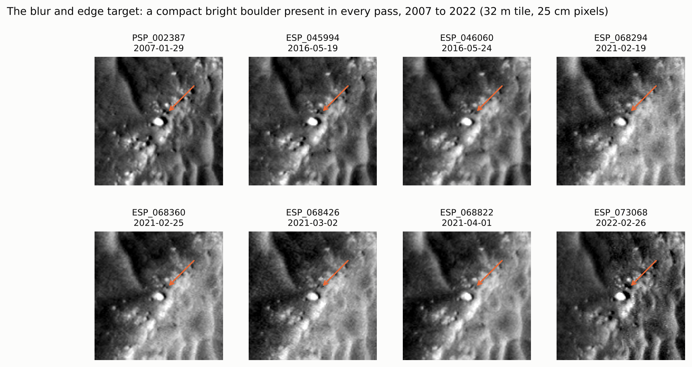
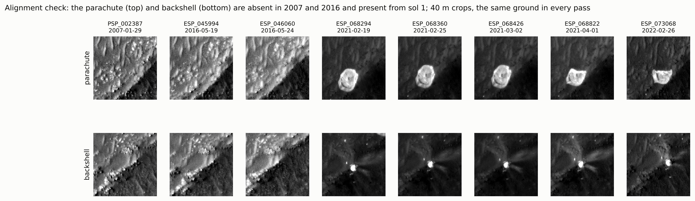
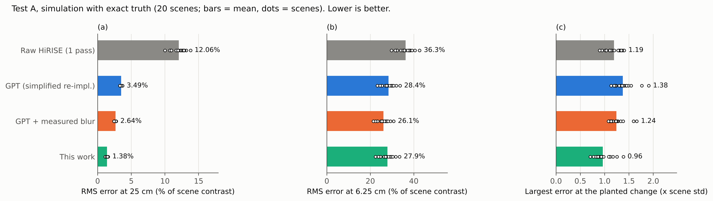
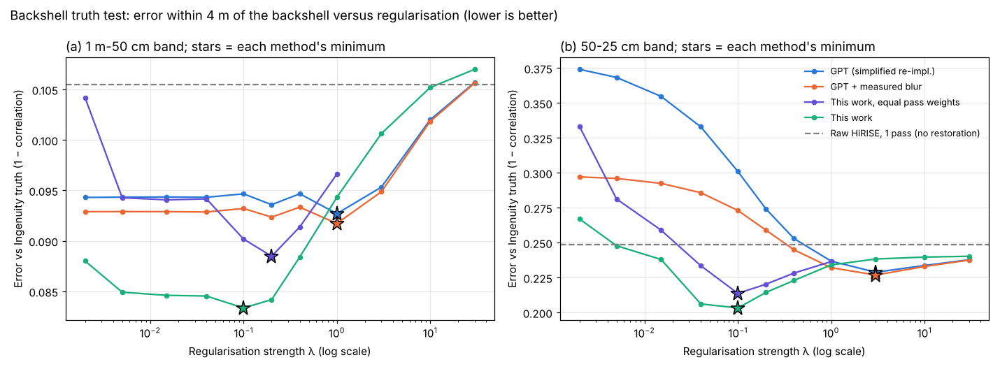
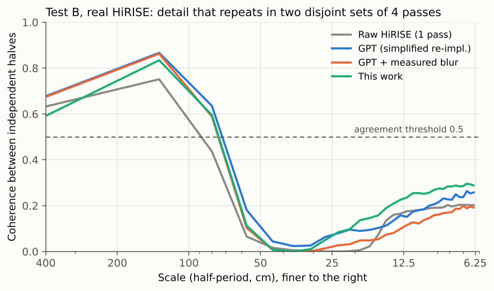
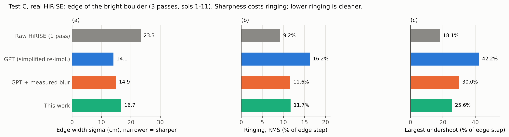
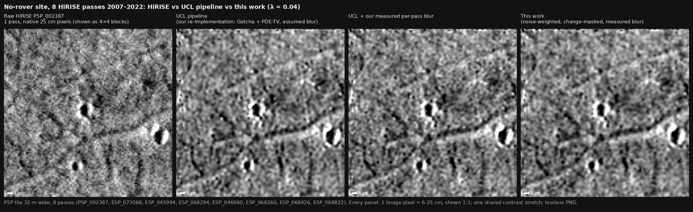
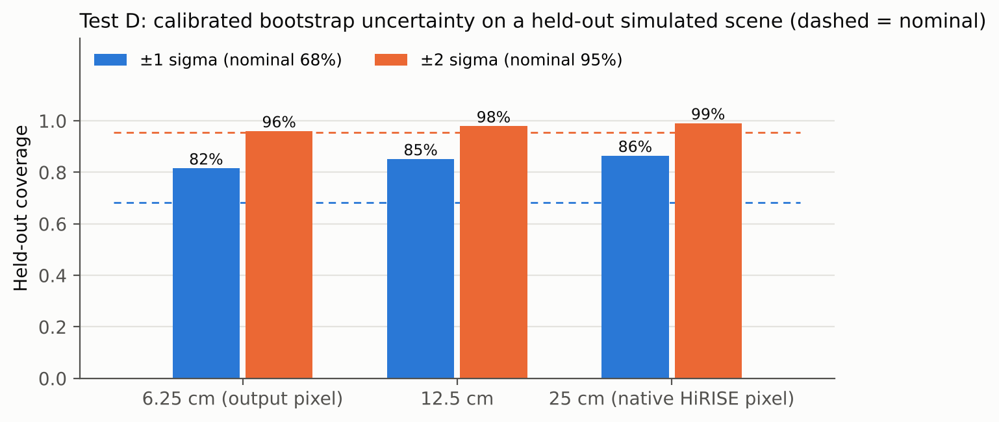

# Revisiting repeat-pass super-resolution of HiRISE: measured blur, measured noise and centimetre-scale truth from Ingenuity

## Abstract

Tao & Muller (2016) showed that eight repeat passes of the 25 cm HiRISE camera can be combined into a restored image on a 5 cm grid. Their Gotcha–PDE-TV (GPT) method has since become the reference for multi-pass super-resolution of Mars. They left three questions open in their paper: the point-spread function of each pass was assumed, the 5 cm figure was, in their words, set "heuristically", and how many images yield what resolution was not yet known. Data from the Perseverance landing area at Jezero crater now let us address all three.

First, we measure each pass's blur on a compact bright boulder visible in every pass. The blur differs by a factor of 2.4 between passes, and 5 of 8 passes are blurrier than the largest value GPT assumes. Second, we test restorations against centimetre-scale truth: Ingenuity photographed the descent backshell from 8 m at about 3 cm per pixel. Third, we measure the scale down to which detail is recovered, using independent sets of passes.

Replacing GPT's assumed blur with the measured one, and weighting each pass by its measured noise, lowers the error at the native 25 cm scale from 3.55% to 1.43% in simulation. The result is also closer to the Ingenuity truth: clearly so at a fixed regularisation strength, and slightly once each method is tuned. On real HiRISE, restorations from two independent sets of four passes agree on detail down to about 67 cm (half-period). In simulation with exact truth, eight passes resolve about 33 cm. HiRISE's 0.5 m optics pass no detail finer than about 20 cm in half-period, however many passes are combined. The 5 cm grid is therefore a sampling choice, and the resolution actually recovered is set by the optics and the data.

## 1. Introduction

The HiRISE camera on Mars Reconnaissance Orbiter images the surface at about 25 cm per pixel (McEwen et al., 2007). That is enough to see boulders a metre across, but not the smaller rocks, ripples and fractures that matter for rover traverses and for choosing targets on the ground. Many sites have been imaged repeatedly, and each pass samples the ground on a slightly different grid. A stack of passes therefore holds information that no single image has, which multi-image super-resolution restoration can recover.

**The GPT result.** Tao & Muller (2016) developed Gotcha–PDE-TV (GPT) for exactly this purpose. Each pass is aligned to a reference image to sub-pixel accuracy with the Gotcha matcher (Otto & Chau, 1989). The method then solves for a fine image whose blurred and down-sampled copies match every pass, with a fourth-order regulariser that keeps edges (You & Kaveh, 2000). Applied to eight HiRISE passes over the Spirit rover's traverse at Home Plate, Gusev crater, GPT produced a mosaic on a 5 cm grid, described as a 5 times higher resolution. They supported it in three ways:
- the spacing of the rover's wheel tracks in the restored image matched the rover's own Navcam mosaic to within 8 cm (1.6 restored pixels);
- automatic detection found 153 rocks of 30 cm or more, against 23 in the original image;
- side-by-side views showed rocks, edges and tracks far more clearly than in the 25 cm input.

The same group later moved to learned single-image methods, such as MARSGAN, and judged those by the sharpness of high-contrast edges (Tao et al., 2021).

**What was left open.** Tao & Muller are explicit about three limits of their study:
1. **The blur.** The point-spread function was "assumed to be a small Gaussian kernel with standard deviation σ 0 to 1", chosen by region. It was not measured.
2. **The resolution.** Of the output grid, they write that they "determined this heuristically at the 5 cm shown for the 8 input 25 cm images". They wrote that they did "not yet know, and are not able to test, owing to the huge computational time, how many images yield what resolution".
3. **The validation.** The wheel-track check and the rock counts confirm where edges lie and how many objects are detected, but there was no independent image of the ground at centimetre scale. Neither check can show whether the 5 cm detail between those edges is real.

**What has changed.** The Perseverance landing area at Jezero now has many HiRISE passes, taken from 2007 to 2024. Among them is a compact bright boulder that is unchanged in every pass, a natural target for measuring each pass's blur. On its 26th flight, the Ingenuity helicopter photographed the descent backshell from 8 m at about 3 cm per pixel: an independent, centimetre-scale view of the ground.

**This paper.** We revisit GPT on each of the three open points:
1. **Blur.** We measure each pass's blur on the boulder and its noise from the image, and use both in place of GPT's assumed blur (Sections 3–4).
2. **Validation.** We test against exact truth in simulation and against the Ingenuity truth on real data (Sections 6.1–6.2).
3. **Resolution.** We measure, on real HiRISE, the finest scale at which two independent sets of passes agree. With simulation and the telescope's diffraction limit, this bounds the resolution that eight passes can deliver (Sections 6.3 and 7.1).

We also give a per-pixel uncertainty from a bootstrap over passes (Section 6.4). Throughout, our baseline is GPT as described in the 2016 paper, with its assumed blur. The code is not public, so we re-implemented it from the paper; it differs only where stated (Section 4).

## 2. Background

**Repeat-pass restoration.** Each low-resolution pass `Y_k` is modelled as the unknown fine image `X`, warped by the pass's motion, blurred by its point-spread function and down-sampled. A maximum a posteriori estimate balances fit to all passes against a smoothness prior. GPT obtains the motion with Gotcha, a region-growing matcher built on adaptive least-squares correlation (Otto & Chau, 1989; Gruen, 1985), seeded by scale-invariant features (Lowe, 2004). Its prior is a fourth-order PDE regulariser (You & Kaveh, 2000), which avoids the staircase artefacts of plain total variation. Later work by the same group moved to learned single-image methods such as MARSGAN (Tao et al., 2021). These produce sharp images, but their added texture comes from training data, so measured and learned detail cannot be told apart.

**Why the blur matters.** The restoration undoes each pass's blur. If the assumed blur is larger than the true blur, the method sharpens too hard and creates ringing next to edges. If it is smaller, real detail is left smeared. Because HiRISE passes differ, a single assumed blur is wrong for most of them.

**How restorations have been judged.** Resolution claims have rested on visual comparison, counts of detected features, and edge sharpness. All three favour a crisper image whether or not the extra detail is real. A fair test needs truth that is independent of the HiRISE passes and finer than them.

## 3. Data

**HiRISE passes.** We use 10 HiRISE RED observations of the Jezero landing area, from 2007 to 2024. All share one map projection, so passes are aligned to the pixel by an integer shift and refined to sub-pixel accuracy by Gotcha. Eight passes with similar sun azimuth (165–178°) are used for restoration.

**Test areas.** We use two 32 m tiles. The first is a texture-rich tile at 18.4472 N, 77.4127 E, seen in all 8 passes. The second, near the landing area at 18.4456 N, 77.4520 E, contains a compact bright boulder of about 2.5 × 1.8 m (Figure 1). Because the boulder is present and unchanged in every pass, it serves as a common target for measuring blur.

**Figure 1.** The blur target: a compact bright boulder visible in every pass from 2007 to 2022 (arrow). Each panel is the same 32 m tile after alignment, at 25 cm per pixel.

**Alignment across fifteen years.** As a check on registration, Figure 2 shows the parachute and backshell 1.1 km west of the boulder tile. They are absent in 2007 and 2016 and appear from the first pass after landing, at the same position in every later pass.

**Figure 2.** The parachute (top) and backshell (bottom), absent before landing and present at the same place in every pass after it. 40 m crops; the parachute's change of shape after March 2021 is visible.

**Ingenuity truth.** On its 26th flight (sol 414), Ingenuity photographed the parachute and backshell from about 8 m with its downward navigation camera, at about 3 cm per pixel. We rectified the fisheye frames and built a mosaic around the backshell. We placed it in HiRISE by two independent methods: the direction of the helicopter's own shadow against the computed sun, and image correlation against three separate HiRISE passes. The two agree on the rotation within their uncertainty (217° ± 12° from the shadow, 208° from correlation), and the correlation recovers the scale expected from the flight height.

## 4. Method

**Forward model.** We estimate the fine image `X`, on a grid four times finer than HiRISE (6.3 cm), by minimising

`E(X) = Σ_k w_k Σ_p m_kp (A_k X − Y_k)_p² + λ Σ_p sqrt(|∇²X|² + μ²)`,

where `A_k` warps `X` by pass k's motion, blurs it with that pass's own Gaussian of width `σ_k`, and down-samples it. The second term is the fourth-order regulariser of GPT, and λ sets its strength. We solve with accelerated gradient descent. The step size comes from the largest eigenvalue of the forward operator, which we measure by power iteration.

**Measured blur.** On three passes we fit brightness profiles across the boulder's short axis with a blurred bar. The other passes are matched to the sharpest one on static ground, which gives their extra blur. The resulting widths range from 0.59 to 1.43 HiRISE pixels. A boulder edge is not a perfect step, so the absolute widths are upper bounds. The ratios between passes are what the restoration relies on.

**Noise weights.** Each pass's weight `w_k` is the inverse of its white-noise variance, measured from its finest-scale pixel differences (Immerkær, 1996). This is deliberately independent of the fit. Weights based on the fit residual, the obvious alternative, read lighting differences between passes as noise and on real data collapse onto a single pass (Section 6.3). Robust per-pixel weights `m_kp` (Tukey) limit the influence of pixels that disagree strongly in one pass.

**Uncertainty.** We rebuild the restoration from passes drawn with replacement. The spread of these rebuilds, scaled by a single factor fitted on one simulated scene and tested on another, gives a per-pixel uncertainty.

**Baseline.** Our GPT baseline follows the paper's equations with one assumed blur width (1 pixel) for every pass and no weighting. The original also varies the blur width between 0 and 1 pixel by image region, which we did not reproduce, so we refer to it as a simplified re-implementation. Its components (Gotcha alignment, the regulariser, the solver) are the same as ours, so the comparison isolates the effect of measured blur and noise.

## 5. Experiments

We use four tests, each answering a different question.

- **A. Simulation with exact truth.** Fractal ground, eight passes with the measured blurs, random sub-pixel offsets plus 0.3-pixel jitter, 3% noise, and a 2 m change planted in one pass. Every method estimates its own motion. This test asks how close each restoration is to the true ground (5 scenes).
- **B. The Ingenuity truth.** Within 4 m of the backshell, we compare each restoration with Ingenuity's view in two bands, 1 m–50 cm and 50–25 cm. We use band-passed correlation with a ±25 cm placement tolerance applied equally to all methods. This test asks whether the restored detail matches the real ground.
- **C. Real-data consistency.** We split the eight real passes into two disjoint halves and restore each half separately. Detail that both halves agree on comes from the data, not the prior. This test asks down to what scale the detail is real.
- **D. A real edge.** On the boulder, we measure the edge width of each restoration together with the ringing and undershoot beside it. This test asks how much artefact each method pays for its sharpness.

## 6. Results

### 6.1 Simulation: measured blur and noise reduce the error at 25 cm

Table 1 and Figure 3 summarise the simulation. At the native 25 cm scale, the GPT baseline leaves an error of 3.55% of scene contrast. Using the measured blur alone reduces it to 2.60%. Adding noise weighting brings it to 1.43%, 60% lower than the baseline, and the improvement holds in every scene. With exact motion the error would be 1.25%, so alignment is not the limiting step. Noise weighting without the measured blur makes the result worse (4.68%): weights only help once the blur model is right. At the finer 6.25 cm output pixel all methods remain far from the truth (errors near 30%), which is the first sign that detail at that scale is not being recovered.

**Table 1.** Simulation with exact truth, mean over 5 scenes. Lower is better.

| Method | Error at 25 cm (%) | Error at 6.25 cm (%) | Largest error at planted change (× std) |
|---|---|---|---|
| Raw HiRISE, one pass | 12.82 | 38.7 | 1.26 |
| GPT (simplified re-implementation), assumed blur 1 px | 3.55 | 30.2 | 1.43 |
| GPT + noise weighting | 4.68 | 32.6 | 1.09 |
| GPT + measured blur | 2.60 | 27.6 | 1.29 |
| **This work** (measured blur + noise weighting) | 1.43 | 29.8 | 1.01 |
| This work with exact motion (upper bound) | 1.25 | 29.8 | 1.00 |

**Figure 3.** Simulation with exact truth. (a) Error at the native 25 cm scale, (b) at the 6.25 cm output pixel, (c) the largest error at a change planted in one pass. Bars are means and dots are individual scenes.

### 6.2 The Ingenuity truth: closer to the real ground

Figure 4 shows the error against Ingenuity's view as the regularisation strength λ varies. At a fixed λ = 0.04, our restoration is clearly closer to the ground than the GPT baseline in the 50–25 cm band (0.206 against 0.333, where 0 is perfect agreement). It also does better in the 1 m–50 cm band (0.085 against 0.094). When each method is given its own best λ, the advantage is smaller: +0.010 (95% interval +0.003 to +0.015) in correlation at 1 m–50 cm and +0.023 (95% interval -0.004 to +0.051) at 50–25 cm. Choosing λ on one half of the area and scoring on the other leaves +0.001 at 1 m–50 cm, essentially no difference, and +0.009 at 50–25 cm. Across 45 plausible placements of the truth, our restoration is ahead in 84% of placements at 1 m–50 cm and 91% at 50–25 cm. The 1 m–50 cm advantage is stable across the radius of the test area (2.5–8 m); the 50–25 cm advantage is not.

**Table 2.** Error against the Ingenuity truth (1 − correlation) within 4 m of the backshell. Lower is better.

| Method | Error, λ = 0.04 (50–25 cm) | Error at own best λ (50–25 cm) | Error, λ = 0.04 (1 m–50 cm) | Error at own best λ (1 m–50 cm) |
|---|---|---|---|---|
| Raw HiRISE, one pass | 0.249 | – | 0.105 | – |
| GPT, assumed blur 1 px | 0.333 | 0.229 (λ = 3.0) | 0.094 | 0.093 (λ = 1.0) |
| GPT + measured blur | 0.286 | 0.227 (λ = 3.0) | 0.093 | 0.092 (λ = 1.0) |
| **This work** | 0.206 | 0.203 (λ = 0.1) | 0.085 | 0.083 (λ = 0.1) |

**Figure 4.** Error against Ingenuity's view versus regularisation strength, in (a) the 1 m–50 cm and (b) the 50–25 cm band. Stars mark each method's minimum; the dashed line is raw HiRISE.

**Figure 5.** The backshell neighbourhood: (a) Ingenuity's view beside (b) raw HiRISE and (c–f) restorations at each method's best and at a typical λ. The bottom row is band-passed to 25 cm–1 m, the scales the test scores.

### 6.3 Real HiRISE: where detail stops being real

Restoring two disjoint halves of the real passes, four passes each, gives a direct measure of repeatable detail (Figure 6). For every method, the two halves agree well at scales above about 1 m and stop agreeing near 67 cm. Because each half has only four passes, this is a conservative figure for an eight-pass restoration. Below that, neither the GPT baseline nor our restoration recovers detail that the other half confirms. Over 25–100 cm the GPT baseline's halves agree slightly more than ours (0.263 against 0.230).

On the boulder edge (Figure 7), the GPT baseline produces the narrowest edge (14.1 cm against 16.7 cm), but at a price. Its ringing is 16.2% of the edge step against 11.7% for ours, and its largest undershoot is 42% against 26%. The assumed blur is larger than the measured blur of the sharpest passes, so the baseline deconvolves too hard. Edge sharpness alone therefore rewards a wrong blur model. Figure 8 shows the restorations side by side.

**Table 3.** Real HiRISE: agreement between independent halves (higher is better) and the boulder edge (narrower is sharper; lower ringing is cleaner).

| Method | Split-half coherence, 25–100 cm | Halves agree down to | Boulder edge σ (cm) | Ringing (% of step) | Largest undershoot (% of step) |
|---|---|---|---|---|---|
| Raw HiRISE, one pass | 0.183 | 100 cm | 23.3 | 9.2 | 18.1 |
| GPT (simplified re-implementation) | 0.263 | 67 cm | 14.1 | 16.2 | 42.2 |
| GPT + measured blur | 0.225 | 67 cm | 14.9 | 11.6 | 30.0 |
| **This work** | 0.230 | 67 cm | 16.7 | 11.7 | 25.6 |

**Figure 6.** Agreement between restorations made from two disjoint sets of four real passes, against scale. Detail counts as repeatable where coherence is at least 0.5 (dashed).

**Figure 7.** The boulder edge on real HiRISE: (a) edge width, (b) ringing, (c) largest undershoot.

**Figure 8.** Eight real passes, 32 m tile. (a) One raw pass; (b) GPT baseline; (c) GPT with measured blur; (d) this work. 6.25 cm pixels shown 1:1 with one shared contrast stretch.

### 6.4 Uncertainty

After calibration on one simulated scene, the bootstrap uncertainty covers the true error on a held-out scene in 86% of pixels at ±1σ and 99% at ±2σ, at the native 25 cm scale (Figure 9). That is more than the nominal 68% and 95%, so the uncertainty errs on the safe side. At the 6.25 cm output pixel, coverage can be matched by calibration, but the uncertainty no longer ranks which pixels are wrong, so we report it at 25 cm.

**Figure 9.** Held-out coverage of the calibrated bootstrap uncertainty at three scales; dashed lines are the nominal 68% and 95%.

## 7. Discussion

### 7.1 Tao & Muller's three open points, revisited

**The blur.** GPT assumes a Gaussian blur of 0 to 1 pixel. On the boulder, the measured blur of the eight passes ranges from 0.59 to 1.43 HiRISE pixels, and 5 of 8 passes are blurrier than 1 pixel (if GPT's σ is in HiRISE pixels, as its forward model suggests). A single assumed value is therefore too sharp for some passes and too soft for others. In simulation, correcting it alone accounts for about half of our gain at 25 cm (3.55% to 2.60%), and noise weighting provides the rest (Section 6.1). It also explains why GPT's restored edges are crisp: the method deconvolves too hard, which shows up as ringing beside edges (Section 6.3).

**The resolution.** Independent four-pass halves of the real data agree on detail down to about 67 cm, and in simulation with exact truth eight passes resolve about 33 cm (both as half-periods). There is also a hard physical limit. HiRISE has a 0.5 m aperture and its RED band is centred at 700 nm. At MRO's range to the surface of roughly 260–320 km, the optics transmit no ground pattern with a period shorter than λR/D ≈ 36–45 cm, a half-period of about 18–22 cm. Sub-pixel shifts between passes can undo the aliasing of HiRISE's pixel grid, but they cannot recover what the telescope never passed, so no number of passes can show real 5 cm detail. Our simulation's 33 cm lies between that limit and the native pixel, as expected, since the optical response is weak near its cutoff. This does not contradict the 2016 results: wheel-track spacing to within 8 cm tests where edges lie, and a fine grid with an edge-preserving prior places edges very precisely. It does mean that "5 cm" describes the sampling of the output, not the size of the smallest real detail it contains. Our numbers come from near-repeat passes at Jezero. Tao & Muller used passes with larger differences in view angle, which may carry more sub-pixel information, so their limit at Gusev could be somewhat finer.

**The validation.** Ingenuity's view of the backshell is, to our knowledge, the first centimetre-scale truth against which a HiRISE restoration has been scored. Against it, the measured-blur restoration is clearly closer to the ground than the GPT baseline at the same regularisation strength. Once each method is tuned, the advantage is small but consistent at 1 m–50 cm. Rock counts and edge sharpness, the two other measures used for Mars super-resolution, both reward a sharper image, which our boulder-edge result shows is not always a more accurate one.

### 7.2 Further discussion

**What the gain is.** The improvement over the GPT baseline comes from measuring two things the baseline assumes: how blurred each pass is, and how noisy. It does not come from a stronger prior. In simulation the measured blur and the noise weighting each provide about half of the gain at 25 cm, and the weighting helps only once the blur is right. Against the Ingenuity truth the gain is largest when both methods use the same regularisation, and small once each is tuned. That is what one would expect if the measured blur mainly removes over-sharpening.

**What multi-pass restoration recovers.** On real HiRISE, detail that independent four-pass halves agree on reaches about 67 cm. In simulation with exact truth, eight passes resolve about 33 cm, and the optics set a floor near 20 cm. All three are well above the 6.3 cm output pixel. The output grid is a sampling choice that lets edges be placed precisely. It is not the resolution of the result, and finer structure in a restored image comes mostly from the regulariser. We suggest that resolution claims for multi-pass restoration be stated as a scale validated against independent passes or independent truth, alongside the output pixel size.

**Edge sharpness is not a fair score on its own.** On the real boulder edge, the sharpest result was also the one with the most ringing. A blur model that is too large looks sharper, so edge-based measures should be reported together with ringing.

**Limitations.**
- The truth comparison uses a single object and its surroundings, about 4 m across. The rock field around it gave no discrimination between methods, because Ingenuity imaged it at midday and HiRISE in the afternoon, so rocks are lit from different directions.
- Our baseline is a simplified GPT, without the original's region-dependent blur width.
- The blur target is a boulder, not a manufactured object, so its absolute blur widths are upper bounds.
- Robust per-pixel weights reduced artefacts at a planted change in simulation, but we have not yet tested them on a real change between passes.

**Outlook.** The same measurements support further products: a per-pixel confidence for small rocks, using agreement between pass subsets and shadows under different sun angles, and maps that flag where the restoration should not be trusted. Validating them needs more centimetre-scale truth, for example from further Ingenuity flights or stereo from rover mast cameras.

## 8. Conclusion

Tao & Muller (2016) showed that repeat HiRISE passes can be combined into much sharper images of Mars, and left open how blurred each pass is, what resolution the result really has, and how to validate it at centimetre scale. At Jezero, all three can now be measured. Replacing GPT's assumed blur with each pass's measured blur, and weighting passes by their measured noise, gives a restoration that is 60% more accurate at 25 cm in simulation and closer to Ingenuity's centimetre-scale view of the ground. Real detail is confirmed by independent passes down to about 67 cm, eight passes resolve about 33 cm in simulation, and the optics allow nothing finer than about 20 cm. We suggest that future multi-pass restorations report such a measured scale alongside the output grid, and validate against independent truth wherever it exists.

## Data and code availability

All HiRISE observations are public through the Planetary Data System; the list with download links is in the repository's `benchmark/data_manifest.json`. The Ingenuity navigation images are from the PDS Mars 2020 helicopter camera archive. All code, tests, result files and the scripts that generate every table and figure in this paper are in the project repository. Full method details are in `docs/METHODS.md`. Every number in this paper is filled in from a result file by `scripts/make_paper.py`. All computation ran on a 4-core CPU.

## References

- Gruen, A. (1985). Adaptive least squares correlation: a powerful image matching technique. *S. Afr. J. Photogramm. Remote Sens. Cartogr.* 14(3), 175–187.
- Immerkær, J. (1996). Fast noise variance estimation. *Comput. Vis. Image Underst.* 64(2), 300–302. doi:10.1006/cviu.1996.0060
- Lowe, D. G. (2004). Distinctive image features from scale-invariant keypoints. *Int. J. Comput. Vis.* 60(2), 91–110.
- McEwen, A. S., et al. (2007). Mars Reconnaissance Orbiter's High Resolution Imaging Science Experiment (HiRISE). *J. Geophys. Res. Planets* 112, E05S02. doi:10.1029/2005JE002605
- Otto, G. P., Chau, T. K. W. (1989). 'Region-growing' algorithm for matching of terrain images. *Image Vis. Comput.* 7(2), 83–94. doi:10.1016/0262-8856(89)90001-2
- Tao, Y., Muller, J.-P. (2016). A novel method for surface exploration: super-resolution restoration of Mars repeat-pass orbital imagery. *Planet. Space Sci.* 121, 103–114. doi:10.1016/j.pss.2015.11.010
- Tao, Y., Conway, S. J., Muller, J.-P., Putri, A. R. D., Thomas, N., Cremonese, G. (2021). Single image super-resolution restoration of TGO CaSSIS colour images: demonstration with Perseverance rover landing site and Mars science targets. *Remote Sens.* 13(9), 1777. doi:10.3390/rs13091777
- You, Y.-L., Kaveh, M. (2000). Fourth-order partial differential equations for noise removal. *IEEE Trans. Image Process.* 9(10), 1723–1730. doi:10.1109/83.869184
