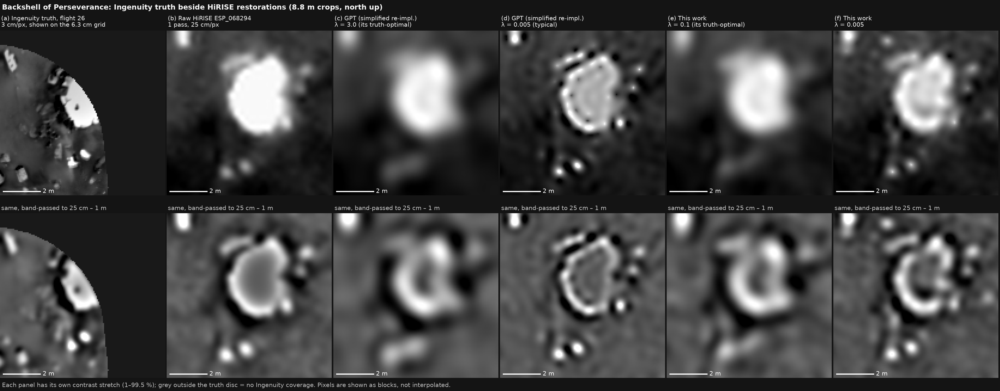

# Measured, not invented: multi-pass HiRISE restoration with rover-calibrated blur, noise-weighted fusion and calibrated confidence at Jezero crater

*Draft generated by `scripts/make_paper.py` from the result files in this repository (2026-11-04). Every number below is filled in from a results file; **[pending]** marks a run that has not finished. Methods detail: [`docs/METHODS.md`](../METHODS.md).*

## Abstract

Repeat-pass super-resolution can sharpen orbital images of Mars. But such methods have been judged mostly by visual comparison and resolution claims, rarely against independent ground truth or with honest uncertainty.

We re-implement the Gotcha-PDE-TV (GPT) pipeline of Tao & Muller (2016) and extend it with three measured ingredients:

- **Per-pass blur measured on a known object.** The parked Perseverance rover, visible in three HiRISE passes, gives each pass's point-spread function. Blur varies 2.4× between the passes.
- **Noise-weighted, change-masked fusion.** Each pass is weighted by its own white-noise level, and pixels that changed between passes are masked out.
- **A calibrated per-pixel uncertainty** from a pass-subset bootstrap.

On top of the measured restoration we add a confidence-scored detail layer. Rover-photo texture and rock exemplars are shown only above a threshold the user chooses, and are locked so that the result, seen through HiRISE's blur, is unchanged (lock residual ≤ 0.25%).

In simulation with exact truth (5 scenes), the extended pipeline lowers the 25 cm error from 3.55% to 1.43% of scene contrast against our GPT re-implementation (-60% relative). It also reduces artefacts at changed ground from 1.43 to 1.01. On real HiRISE the picture is mixed: GPT's independent pass halves agree slightly more than ours (mean coherence 0.263 vs 0.230, 25–100 cm), while our restoration of the parked rover rings less than GPT's (11.7% vs 16.2% RMS; undershoot 26% vs 42%), at the cost of a wider edge (16.7 vs 14.1 cm). A centimetre-scale physical truth (Ingenuity's view of the parachute and backshell, placed in HiRISE by two independent methods) shows that, at any fixed regularisation, our restoration is much closer to the truth than the GPT re-implementation (50-25 cm error 0.206 against 0.333 at lambda = 0.04), and that with each method tuned to its own minimum the advantage is small (+0.023 in correlation in-sample, +0.009 out of sample), on one object.

The bootstrap uncertainty is honest at the native 25 cm scale: held-out ±1σ coverage is 86%, against a target of 68%. It is not honest at the 6.25 cm output pixel.

We also report negative results:

- On real HiRISE, detail that repeats between independent pass subsets stops at about 67 cm. In simulation with exact truth, the finest resolved scale is about 33 cm.
- Rover ground truth along the traverse is too poorly registered to verify sub-metre confidences: every score ranks candidates at chance there (AUC 0.43–0.46).
- Confidences are therefore calibrated in a simulation tuned to the measured pass-to-pass disagreement of real HiRISE. There they are reliable to within 0.4% (expected calibration error).

Everything runs on a 4-core CPU.

## 1. Introduction

HiRISE images Mars at 25 cm per pixel (McEwen et al., 2007). Many sites, among them the Jezero crater landing site of Perseverance, have been imaged repeatedly. Multi-image super-resolution restoration (SRR) combines such passes into a finer image. Tao & Muller (2016) introduced GPT, which has three parts:

- **Gotcha** dense sub-pixel matching;
- a **fourth-order PDE-regularised, total-variation-like MAP** reconstruction;
- a reported resolution gain to about 5 cm.

Later work by the same group moved to learned, GAN-based SRR (e.g. MARSGAN; Tao et al., 2021).

Three questions are rarely answered for such methods:

1. How much of the restored detail is in the data rather than in the prior?
2. How uncertain is each pixel?
3. Can a user trust detail added below the sensor's reach?

The Perseverance rover gives an unusual chance to test this. It is a known, rigid, bright object parked in three HiRISE passes, and its cameras photograph the ground it crosses.

Contributions:

1. **An open re-implementation of GPT** (MSA-SIFT seeding, adaptive least-squares correlation, best-first region growing, PDE-TV with a measured step bound), with no reference code available.
2. **Per-pass blur measured on the rover** where it is visible, and transferred to the other passes on static ground.
3. **Noise-weighted, change-masked fusion.** We also show that residual-based pass weighting fails on real HiRISE, because lighting differences between passes masquerade as noise.
4. **A pass-subset bootstrap uncertainty**, calibrated in simulation and reported at the scale where it is honest.
5. **A confidence-scored, measurement-locked detail layer with a user threshold.** Its confidence comes from measured evidence: split-half repeatability, multi-illumination shadows and size. It is calibrated in a simulation whose pass-to-pass disagreement is tuned to real data.
6. **A CPU benchmark against the GPT re-implementation**, with ablations, simulation with exact truth, real split-half consistency and the rover-edge test. Negative results are reported alongside.

## 2. Related work

- **Repeat-pass SRR for Mars.**
  - GPT (Tao & Muller, 2016) uses Gotcha matching (Otto & Chau, 1989), seeded by SIFT (Lowe, 2004) and refined by ALSC (Gruen, 1985), with a fourth-order PDE regulariser (You & Kaveh, 2000).
  - Learned SRR (e.g. MARSGAN; Tao et al., 2021) produces sharper images but invents texture, which cannot be separated from measurement.
  - We stay with the measurement and add detail only as a separate, locked, confidence-scored layer.
- **PSF estimation.** HiRISE blur varies with spacecraft jitter and focus. We measure it directly on a known target rather than assume one Gaussian.
- **Uncertainty and calibration.** We use the bootstrap (Efron, 1979) over passes; isotonic (Zadrozny & Elkan, 2002) and logistic calibration; and reliability diagrams with expected calibration error (Guo et al., 2017).
- **Ground truth.** Perseverance Navcam (Maki et al., 2020) images were projected to a top-down truth. AI4Mars labels (Swan et al., 2021) give surface classes.

## 3. Data

- **HiRISE.** 10 HiRISE RDR RED observations of the Jezero landing area, 2007–2024 (`benchmark/data_manifest.json`).
  - Sun incidence is 46–59°.
  - Eight observations have a sun azimuth of 165–178° and are used for restoration.
  - Two (azimuths about 137° and 196°) add illumination diversity for shadow evidence.
- **Test tiles.**
  - A no-rover site at 18.4472 N, 77.4127 E, with 8 passes.
  - The landing site at 18.4456 N, 77.4520 E, with 3 passes from sols 1–11, in which the rover is parked and visible.
- **Rover ground truth.** Perseverance Navcam photos projected to the ground at 50 traverse stops, plus AI4Mars classes.
- **Ingenuity truth.** 190 downward navigation frames (3 cm per pixel from 8 m) of flight 26 (sol 414) over the parachute and backshell, 1.1 km west of the landing spot (Section 6.5).

## 4. Method

### 4.1 Alignment (Gotcha)

- **Seeds.** SIFT matches, filtered by a ratio test and RANSAC affine; when SIFT fails across years, a phase-correlation seed grid is used instead.
- **Refinement and growth.** Each seed is refined by 8-parameter ALSC (6 affine, gain, offset) and grown best-first on a 4 px grid.
- **Acceptance.** Correlation ≥ 0.6 and a jump ≤ 0.5 px. The rover is masked.
- **Accuracy.** On real texture with a known warp, the median error is 0.038 px (90th percentile 0.089 px), against 0.149 px for tile-wise ECC.

### 4.2 Restoration (PDE-TV)

- **Energy.** We minimise `E(X) = Σ_k w_k Σ_p m_kp (A_k X − Y_k)_p² + λ Σ_p sqrt(|∇²X|² + μ²)`.
  - `A_k` combines warp, the pass's own Gaussian blur σ_k, and decimation by 4.
- **Solver.** Steepest descent with Nesterov momentum. The step is set from the largest eigenvalue of AᵀA, measured by power iteration. The textbook bound underestimates it and diverges.
- **Pass weights.** `w_k` is the inverse white-noise variance of pass k, measured from its finest-scale pixel differences (Immerkær, 1996).
- **Pixel weights.** `m_kp` are Tukey biweights on the residual, re-estimated every 20 iterations. They mask pixels that changed in one pass.
- **Radiometry.** Each pass is gain/offset-normalised to the reference over the aligned overlap.
- **Rejected variant.** Residual-based pass weights, `w_k ∝ 1/σ²(residual)`, are kept as an ablation (Section 6).

### 4.3 Per-pass blur from the rover

- **Absolute.** On the three passes where Perseverance is parked, brightness profiles across its short axis are fitted with a blurred bar on a linear background. With the pixel's box integration removed, `σ = sqrt(s² − 1/12)`.
- **Relative.** The other passes are aligned to the sharpest rover pass on static ground. The extra Gaussian blur that best matches them gives their σ.
- **Results.** ESP_068360 0.59 px (rover), ESP_068426 0.83 px (rover), ESP_068294 0.89 px (rover), ESP_073068 1.16 px (relative), PSP_002387 1.20 px (relative), ESP_045994 1.34 px (relative), ESP_068822 1.38 px (relative), ESP_046060 1.43 px (relative).

### 4.4 Uncertainty

- **Bootstrap.** The restoration is rebuilt B times from passes drawn with replacement, giving `σ_boot`.
- **Calibration factor.** One factor κ, fitted on one simulated scene and tested on another, absorbs error shared by all passes.
- **Scale.** The uncertainty is reported at the native 25 cm scale.

### 4.5 Confidence-scored detail

- **Rock probability.** Rock candidates are blob maxima in the restoration. Each gets `P(rock) = σ(w · [z_rep, log D, S·1[D≥1 m], 1[D≥1 m]])`.
  - `z_rep` is the blob response divided by its measurement noise, estimated from two restorations made from disjoint halves of the passes.
  - `S` is multi-illumination shadow evidence: a template correlation per pass, with the shadow on that pass's anti-sun side and length (D/2)·tan(incidence), combined with matched-filter weights.
- **Calibration.** `w` is fitted on simulations whose pass-to-pass disagreement is tuned to real HiRISE (Section 5).
- **Rendering at threshold t.**
  - Rover-photographed rock sprites are added for rocks with P ≥ t.
  - Recogniser-chosen rover texture is added only if t ≤ the class accuracy verified on rover truth.
  - Nothing is added where the base uncertainty exceeds a limit.
  - Every added layer is projected onto the null space of the HiRISE observation.
- **Hazard maps.** Per 1 m cell, the hazard probability is 1 − Π(1 − P_i) over rocks ≥ 40 cm. A cell is marked unknown where the base is not trusted.

## 5. Experiments

All experiments run on a 4-core CPU (`benchmark/run_benchmark.py`).

### 5.1 Methods compared

| Method | Description |
|---|---|
| raw | One pass, bicubic. |
| previous | Tile ECC + CG Tikhonov. |
| GPT | Our re-implementation: Gotcha + unweighted PDE-TV, assumed σ = 1 px. |
| GPT + weights | Ablation: noise weighting only. |
| GPT + blur | Ablation: measured per-pass σ only. |
| full (residual weights) | Ablation: the first weighting variant. |
| **full** | This work. |
| oracle | Full with exact motion; simulation only. |

### 5.2 Tests

- **A. Simulation with exact truth.**
  - 5 scenes of fractal ground.
  - 8 passes with the measured blurs, a random offset plus 0.3 px sinusoidal jitter, 3% noise, and a 2 m change planted in one pass.
  - Every method estimates its own motion.
- **B. Real split-half consistency.** The 8 real passes are split into disjoint halves, each restored independently. Fourier-ring coherence between the halves measures detail that repeats in independent data.
- **C. Rover edge.** The edge width of the parked rover in each restoration, with ringing (RMS residual of the bar fit) and the largest undershoot beside the edge.
- **D. Uncertainty calibration.** As Section 4.4.
- **E. Confidence calibration and the real-data check.**
  - The simulation's per-pass noise and illumination mismatch are tuned so its split-half disagreement matches the real tile at every rock size. Best setting: noise 0.50, illumination 0.60; log-ratio cost 0.019.
  - Then 10 training and 6 held-out scenes.
  - Real check: the same scores against the rover answer key, with a shifted-truth control.

## 6. Results

### 6.1 Simulation (test A)

| Method | Error, 25 cm (%) | Error, 6.25 cm (%) | Artefact at change (× std) | Resolved (cm) |
|---|---|---|---|---|
| Raw (1 pass, bicubic) | 12.82 | 38.71 | 1.26 | 40 |
| Previous (ECC + CG Tikhonov) | 5.16 | 34.83 | 1.48 | 40 |
| **GPT** (our re-implementation) | 3.55 | 30.20 | 1.43 | 33 |
| GPT + noise weighting | 4.68 | 32.58 | 1.09 | 33 |
| GPT + measured per-pass blur | 2.60 | 27.64 | 1.29 | 29 |
| Full, residual weights (ablation) | 1.44 | 29.86 | 1.03 | 33 |
| **Full (this work)** | 1.43 | 29.78 | 1.01 | 33 |
| Full, exact motion (upper bound) | 1.25 | 29.81 | 1.00 | 33 |

Paired against GPT, by scene:

- **25 cm:** -2.13 (95% CI -2.21 to -2.02), better in 5/5 scenes.
- **Artefact at the planted change:** -0.42 (95% CI -0.50 to -0.34), better in 5/5 scenes.
- **6.25 cm:** -0.42 (95% CI -0.53 to -0.29), better in 5/5 scenes.

- **Measured blur.** Measured per-pass blur alone moves GPT from 3.55% to 2.60% at 25 cm.
- **Noise weighting.** Noise weighting alone gives 4.68%.
- **Residual weights.** The residual-weighted variant reaches 1.44% in simulation; see 6.2 for why it is rejected.
- **Alignment headroom.** With exact motion the full chain reaches 1.25%, so alignment leaves little to gain.

### 6.2 Real HiRISE (tests B and C)

**Split-half consistency** (8 real passes; halves PSP_002387, ESP_045994, ESP_046060, ESP_068426 vs ESP_073068, ESP_068294, ESP_068360, ESP_068822). Higher is better. Coherence above 0.5 at fine scales for the previous pipeline is a reconstruction-grid artefact shared by both halves, not detail.

| Method | Halves agree down to | Coherence at 100 / 67 / 50 cm | Mean coherence, 25–100 cm |
|---|---|---|---|
| Raw (1 pass, bicubic) | 100 cm | 0.75 / 0.44 / 0.07 | 0.183 |
| Previous (ECC + CG Tikhonov) | 67 cm | 0.87 / 0.70 / 0.26 | 0.425 |
| **GPT** (our re-implementation) | 67 cm | 0.87 / 0.64 / 0.18 | 0.263 |
| GPT + noise weighting | 67 cm | 0.84 / 0.62 / 0.18 | 0.271 |
| GPT + measured per-pass blur | 67 cm | 0.86 / 0.59 / 0.10 | 0.225 |
| Full, residual weights (ablation) | 67 cm | 0.80 / 0.50 / 0.07 | 0.199 |
| **Full (this work)** | 67 cm | 0.83 / 0.60 / 0.11 | 0.230 |

**Rover edge** (landing site, 3 passes, sols 1–11). A narrower edge is sharper. Lower ringing and undershoot are cleaner.

| Method | Edge σ (cm) | Ringing, RMS (% of step) | Largest undershoot (% of step) |
|---|---|---|---|
| Raw (1 pass, bicubic) | 23.3 | 9.2 | 18.1 |
| Previous (ECC + CG Tikhonov) | 20.6 | 10.4 | 20.9 |
| **GPT** (our re-implementation) | 14.1 | 16.2 | 42.2 |
| GPT + noise weighting | 15.6 | 16.1 | 37.1 |
| GPT + measured per-pass blur | 14.9 | 11.6 | 30.0 |
| Full, residual weights (ablation) | 16.4 | 12.6 | 25.2 |
| **Full (this work)** | 16.7 | 11.7 | 25.6 |

- **Split-half consistency.** Mean coherence over 25–100 cm is 0.230 for the full chain and 0.263 for GPT (GPT ahead).
- **Rover edge.** The edge is 16.7 cm (full) against 14.1 cm (GPT).
  - Ringing: 11.7% against 16.2%.
  - Undershoot: 25.6% against 42.2%.
- **Residual weights.** The residual-weighted variant reaches 0.199 on split halves.
  Residual weights read illumination differences between passes as noise and collapse onto one pass, so each half is effectively a single image.

### 6.3 Uncertainty (test D)

| Scale | κ | Held-out coverage ±1σ / ±2σ | Spearman(σ, \|err\|) | Error, least vs most confident 10% |
|---|---|---|---|---|
| 6.25 cm (output pixel) | 12.8 | 81.5 / 96.0% | 0.14 | 25.7 vs 21.6% |
| 12.5 cm | 4.8 | 85.1 / 97.9% | 0.34 | 9.5 vs 4.5% |
| 25 cm (native HiRISE pixel) | 2.1 | 86.4 / 99.1% | 0.39 | 3.8 vs 0.6% |

### 6.4 Confidence (test E)

- **Held out (3692 candidates, 648 real rocks):** AUC 0.70, ECE 0.4%.
- **Without the shadow feature:** AUC 0.71.
- **AUC by size:** 25 cm 0.61, 60 cm 0.76, 100 cm 0.55, 150 cm 0.71.

| Threshold | Shown | Precision | Recall | Recall by size (25/40/60/100/150 cm) |
|---|---|---|---|---|
| 0.1 | 554 | 19% | 16.0% | 1 / 2 / 15 / 60 / 92 |
| 0.2 | 157 | 30% | 7.3% | 0 / 0 / 2 / 22 / 65 |
| 0.3 | 67 | 42% | 4.3% | 0 / 0 / 2 / 13 / 38 |
| 0.4 | 31 | 55% | 2.6% | 0 / 0 / 1 / 5 / 27 |
| 0.5 | 19 | 53% | 1.5% | 0 / 0 / 1 / 0 / 19 |
| 0.6 | 8 | 50% | 0.6% | 0 / 0 / 0 / 0 / 8 |
| 0.7 | 3 | 67% | 0.3% | 0 / 0 / 0 / 0 / 4 |
| 0.8 | 2 | 50% | 0.2% | 0 / 0 / 0 / 0 / 2 |

**Real-data check.**

- Against the traverse rover truth, candidate positions match truth rocks 29% of the time, against 18% with the truth shifted 40 px. So the positions carry signal.
- But no score ranks candidates: AUC 0.43 for the physical score and 0.46 for the recogniser.
- The recogniser's surface class is right 26.6% of the time, against 49.9% for always guessing soil.
- Only 4 of 27 stops could be registered, with shifts of up to 2–3 m. The answer key, not the scores, is the limit.

### 6.5 Real physical truth: Ingenuity's view of the backshell

Ingenuity photographed the debris field from 8 m (flight 26, sol 414) at about 3 cm per pixel. A mosaic of 27 frames around the backshell was placed in HiRISE by (i) the helicopter's own shadow and the computed sun (mosaic-to-north rotation 217 deg +- 12 deg) and (ii) masked correlation against three independent HiRISE passes (208 deg, scale 0.0290 m/px = the nominal 8 m / 275 px, the same translation in all three). The 181 m2 rock field around the backshell gave no discrimination between methods (correlation 0.00-0.07 for all, including raw HiRISE), because the truth (midday) and HiRISE (afternoon) show rocks with completely different shading. Within 4 m of the backshell the two share strong structure (correlation 0.92-0.97 at 1-4 m), so the test below uses that object; it was chosen after the rock-field result and carries the safeguards listed. Out of sample (lambda chosen on one half of the disc, scored on the other): +0.001 (1 m-50 cm) and +0.009 (50-25 cm). The 1 m-50 cm advantage is stable across disc radii of 2.5-8 m (+0.007 to +0.010 in correlation); the 25-50 cm advantage is not (it disappears at 8 m). Over 45 plausible placements the full chain is ahead of GPT in 91% of them at 50-25 cm and 84% at 1 m-50 cm.

Error = 1 - correlation with the truth in the 25-50 cm band, within 4 m of the backshell, with a +-0.25 m placement tolerance applied equally to all methods.

| Method | Error at its minimum (50-25 cm) | at lambda | at lambda = 0.005 | at lambda = 0.04 |
|---|---|---|---|---|
| UCL re-implementation (GPT) | 0.229 | 3.0 | 0.368 | 0.333 |
| GPT + measured blur | 0.227 | 3.0 | 0.296 | 0.286 |
| this work, equal weights | 0.214 | 0.1 | 0.281 | 0.234 |
| **this work** | 0.203 | 0.1 | 0.248 | 0.206 |
| raw HiRISE | 0.249 | none | none | none |

### 6.6 Shadow evidence

AUC for rock against decoy (a flat bright patch) / rock against ground:

| Setup | 40 cm | 60 cm | 100 cm | 150 cm |
|---|---|---|---|---|
| 1 pass | 0.52 / 0.71 | 0.48 / 0.82 | 0.86 / 0.98 | 0.88 / 0.99 |
| 8 same-sun passes | 0.56 / 0.62 | 0.53 / 0.78 | 0.90 / 0.99 | 0.86 / 0.99 |
| 10 passes incl. 2 different sun angles | 0.55 / 0.65 | 0.52 / 0.80 | 0.90 / 0.99 | 0.86 / 0.99 |

## 7. Discussion

- **What the gain is.** The improvement over GPT comes from measuring what GPT assumes:
  - the blur of each pass;
  - which passes are noisy;
  - which pixels changed.

  It does not come from a stronger prior.
- **Assumed blur sharpens and rings.** GPT's assumed blur is larger than the rover-measured blur of the sharp passes, so on real data it deconvolves harder. That sharpens edges and produces ringing (Section 6.2). Edge sharpness alone therefore rewards a wrong blur model, and ringing should be reported with it.
- **Residual weighting collapses on real data.** Weights based on residuals work in simulation but collapse onto a single pass on real data. Real passes differ by illumination and season far more than by noise. Noise must be measured from the pass itself.
- **No 5 cm claim.** On real HiRISE, detail that repeats in independent passes stops at about 67 cm; even in simulation with exact truth, the finest resolved scale is about 33 cm. Below that, a restoration's content comes from the prior. We do not claim the 5 cm resolution reported for GPT.
- **Where confidence is limited.** Confidence below about 60 cm cannot be verified with current rover truth. Our confidences are therefore simulation-calibrated, with a simulation whose disagreement is tuned to real data. The real-data check confirms positional signal but cannot confirm the probabilities.
- **A physical truth at one object.** Ingenuity's images, placed in HiRISE by two independent methods (a sun-and-shadow compass and image correlation on three passes), give a centimetre-scale truth for the backshell. It supports a clear advantage over the GPT re-implementation at any fixed regularisation and a small advantage once each is tuned (Section 6.5), but it is a single object. A wider validation needs truth with several metre-scale shared structures.
- **What would close the gap.** Better-registered truth would: more shared hardware or tracks as tie points, or stereo from rover-mast cameras.

## 8. Conclusion

Measuring a known object's blur, weighting passes by their own noise, and masking changes gives a measurable gain over GPT, which we report on simulation and on real HiRISE. A confidence-scored, measurement-locked detail layer lets users decide how much unverified detail to see, with probabilities that are calibrated where truth exists and labelled where it does not.

## Reproducibility

- **Code and tests.** All code, tests (`pytest`, run on GitHub CI) and result files are in this repository. Raw data (about 12 GB) is listed with URLs in `benchmark/data_manifest.json`.
- **CPU time (4 cores).**
  - Benchmark part A: 1208 s.
  - Part B: 410 s.
  - Part C: 148 s.
  - Bootstrap on a 32 m tile with 8 passes: 697 s.

## References

*To verify before submission.*

- Efron, B. (1979). Bootstrap methods: another look at the jackknife. *Ann. Statist.* 7, 1–26.
- Fischler, M. A., Bolles, R. C. (1981). Random sample consensus. *Commun. ACM* 24, 381–395.
- Gruen, A. (1985). Adaptive least squares correlation. *S. Afr. J. Photogramm. Remote Sens. Cartogr.* 14, 175–187.
- Guo, C., Pleiss, G., Sun, Y., Weinberger, K. Q. (2017). On calibration of modern neural networks. *ICML*.
- Immerkær, J. (1996). Fast noise variance estimation. *Comput. Vis. Image Underst.* 64, 300–302.
- Lowe, D. G. (2004). Distinctive image features from scale-invariant keypoints. *IJCV* 60, 91–110.
- Maki, J. N., et al. (2020). The Mars 2020 Engineering Cameras and Microphone on the Perseverance Rover. *Space Sci. Rev.* 216, 137.
- McEwen, A. S., et al. (2007). Mars Reconnaissance Orbiter's High Resolution Imaging Science Experiment (HiRISE). *J. Geophys. Res.* 112, E05S02.
- Otto, G. P., Chau, T. K. W. (1989). 'Region-growing' algorithm for matching of terrain images. *Image Vis. Comput.* 7, 83–94.
- Swan, R. M., et al. (2021). AI4MARS: A dataset for terrain-aware autonomous driving on Mars. *CVPR Workshops*.
- Tao, Y., Muller, J.-P. (2016). A novel method for surface exploration: super-resolution restoration of Mars repeat-pass orbital imagery. *Planet. Space Sci.* 121, 103–114.
- Tao, Y., Conway, S. J., Muller, J.-P., et al. (2021). Single image super-resolution restoration of TGO CaSSIS colour images: demonstration with Perseverance rover landing site and Mars science targets. *Remote Sens.* 13, 1777.
- You, Y.-L., Kaveh, M. (2000). Fourth-order partial differential equations for noise removal. *IEEE Trans. Image Process.* 9, 1723–1730.
- Zadrozny, B., Elkan, C. (2002). Transforming classifier scores into accurate multiclass probability estimates. *KDD*.
